# Лабораторная работа № 4
## Основы MLOps: эксперименты, реестр моделей и контейнеризация

**Вариант 17 — прогноз выработки электростанции**<br>
**Набор данных:** UCI Combined Cycle Power Plant (CCPP).<br>
**Задача:** `AT, V, AP, RH → PE`, регрессия.<br>
**Основные алгоритмы:** Ridge и RandomForestRegressor. **Критерий выбора:** MAE на validation.<br>
**Дата выполнения на Ubuntu:** 10 ноября 2026 года, UTC+07:00. **Год:** 2026.

Отчёт оформлен по структуре первой лабораторной: выполненные кодовые ячейки,
таблицы, пояснения после вычислений, рисунки и полный исходный код в приложении.
Измерения обучения и Docker получены в Ubuntu 22.04.5 ARM64. Этот notebook
загружает и проверяет сохранённые результаты; его выполнение не запускает
повторное обучение, контейнеры или новый MLflow. Скриншоты оставлены без изменений.

### Содержание

1. Цель и постановка задачи.
2. Набор данных и источник.
3. Подготовка и разбиение.
4. Программное окружение и структура.
5. Последовательность выполнения.
6. Сравнение шести экспериментов.
7. Выбор модели и итоговая оценка.
8. Model Registry и champion.
9. Экспорт и контракт API.
10. Сборка Docker и проверка предсказаний.
11. Обновление и откат.
12. Docker Compose и healthcheck.
13. Воспроизводимость и проверка артефактов.
14. Выводы.
15. Источники.
16. Приложение: программный код и примеры запросов.

### 1. Цель и постановка задачи

Цель — освоить учёт и сравнение экспериментов в MLflow, регистрацию версий
моделей, доставку сервиса предсказаний через Docker и Compose, проверку API,
обновление и откат без переобучения.

Для варианта 17 требуется прогнозировать PE по параметрам среды. Нужно:
выбрать источник и метрики; подготовить train/validation/test; выполнить не менее
шести экспериментов; сохранить параметры, метрики, теги и артефакты;
зарегистрировать минимум две версии и назначить champion; экспортировать Pipeline;
создать API и Dockerfile; проверить корректные/некорректные запросы и численное
совпадение; продемонстрировать обновление, откат и Compose healthcheck;
зафиксировать исходные данные, зависимости и разбиение.

Особенности варианта: используется одна таблица, повторные листы не объединяются;
единицы измерения входят в описание, теги/артефакты MLflow и метаданные экспорта.

MLflow Tracking группирует запуски в experiment и хранит параметры/метрики;
Model Registry даёт модели имя и версии. Alias — изменяемая ссылка на версию.
Docker-образ содержит приложение и конкретный снимок модели, а контейнер является
запущенным экземпляром образа. Смена alias сама по себе не обновляет контейнер.

```python
from pathlib import Path
import hashlib
import json
import runpy
import numpy as np
import pandas as pd
from IPython.display import display, Image, Markdown

ROOT = Path.cwd()
assert (ROOT / "reports/experiments.json").is_file(), "Run this notebook from the repository root"

def read_json(path):
    return json.loads((ROOT / path).read_text())

def table(headers, rows):
    def cell(value):
        return str(value).replace("|", "\\|").replace("\n", " ")
    text = "| " + " | ".join(map(cell, headers)) + " |\n"
    text += "|" + "|".join("---" for _ in headers) + "|\n"
    text += "\n".join("| " + " | ".join(map(cell, row)) + " |" for row in rows)
    display(Markdown(text))

def figure(path, caption):
    display(Image(filename=str(ROOT / path), width=1200))
    display(Markdown("**" + caption + "**"))

audit = read_json("reports/data_audit.json")
registry = read_json("reports/registry.json")
runs = read_json("reports/experiments.json")
test = read_json("reports/test_metrics.json")
environment = read_json("reports/environment.json")
print("Сохранённых экспериментов:", len(runs))
print("Registry:", registry["model_name"], "; выбранная версия:", registry["versions"]["selected"]["model_version"])
```

```text
Сохранённых экспериментов: 6
Registry: ccpp-power ; выбранная версия: 2
```

Инициализация читает результаты, полученные на Ubuntu, и определяет общие
функции вывода таблиц и рисунков. Путь notebook не используется как доказательство
платформы обучения: сведения о ней берутся из `reports/environment.json` и скриншотов.

### 2. Набор данных и источник

Используется [Combined Cycle Power Plant, UCI, ID 294](https://archive.ics.uci.edu/dataset/294/combined+cycle+power+plant),
DOI: [10.24432/C5002N](https://doi.org/10.24432/C5002N).
Прямой архив: `https://archive.ics.uci.edu/static/public/294/combined+cycle+power+plant.zip`.

По `CCPP/Readme.txt` исходного архива наблюдения собраны в 2006–2011 годах
на электростанции комбинированного цикла при полной нагрузке. Газовая и паровая
турбины работают в едином цикле. Признаки — средние почасовые параметры;
выходная переменная отражает электрическую мощность в MW. Хотя в названии
задания употреблено слово «выработка», **PE в этой работе измеряется в МВт,
а не в МВт·ч**. В workbook цель названа `PE`; в исходном Readme встречается `EP`.

Источник содержит XLSX/ODS с пятью перемешиваниями одной выборки для 5×2 CV.
В работе берётся только `Sheet1` файла `Folds5x2_pp.xlsx`: 9568 строк, четыре
числовых признака и одна цель. Повторные листы не увеличивают размер датасета.

```python
raw = pd.read_excel(ROOT / "data/raw/Folds5x2_pp.xlsx", sheet_name="Sheet1")
clean = pd.read_csv(ROOT / "data/processed/data.csv")
variables = [
    ("AT", "Температура окружающей среды", "°C"),
    ("V", "Вакуум на выхлопе паровой турбины", "cm Hg, см рт. ст."),
    ("AP", "Атмосферное давление", "mbar, мбар"),
    ("RH", "Относительная влажность", "%"),
    ("PE", "Целевая электрическая мощность", "MW, МВт"),
]
table(["Переменная", "Назначение", "Единицы", "Минимум", "Максимум"],
      [[name, description, unit, f"{raw[name].min():.2f}", f"{raw[name].max():.2f}"] for name, description, unit in variables])
print("Исходная форма:", raw.shape, "; пропусков:", int(raw.isna().sum().sum()))
```

| Переменная | Назначение | Единицы | Минимум | Максимум |
|---|---|---|---|---|
| AT | Температура окружающей среды | °C | 1.81 | 37.11 |
| V | Вакуум на выхлопе паровой турбины | cm Hg, см рт. ст. | 25.36 | 81.56 |
| AP | Атмосферное давление | mbar, мбар | 992.89 | 1033.30 |
| RH | Относительная влажность | % | 25.56 | 100.16 |
| PE | Целевая электрическая мощность | MW, МВт | 420.26 | 495.76 |

```text
Исходная форма: (9568, 5) ; пропусков: 0
```

Все пять столбцов числовые, категориальное кодирование не требуется.
Диапазоны относятся к исходной таблице; они используются для описания и контроля
источника, а не для подбора модели по test. Диапазон RH достигает 100,16%:
измерения немного выше теоретических 100% документируются, сохраняются без
обрезки и не удаляются как ошибочные автоматически.

```python
excel = pd.ExcelFile(ROOT / "data/raw/Folds5x2_pp.xlsx")
reference_hashes = np.sort(pd.util.hash_pandas_object(raw, index=False).to_numpy())
sheet_rows = []
for name in excel.sheet_names:
    frame = pd.read_excel(excel, sheet_name=name)
    same = np.array_equal(np.sort(pd.util.hash_pandas_object(frame, index=False).to_numpy()), reference_hashes)
    sheet_rows.append([name, len(frame), "да" if same else "нет", "да" if name == "Sheet1" else "нет"])
table(["Лист", "Строк", "То же мультимножество строк, что Sheet1", "Используется для обучения"], sheet_rows)
```

| Лист | Строк | То же мультимножество строк, что Sheet1 | Используется для обучения |
|---|---|---|---|
| Sheet1 | 9568 | да | да |
| Sheet2 | 9568 | да | нет |
| Sheet3 | 9568 | да | нет |
| Sheet4 | 9568 | да | нет |
| Sheet5 | 9568 | да | нет |

Проверка сравнивает строки с учётом их кратности и без учёта порядка:
все пять листов являются перестановками одной таблицы. Их объединение дало бы
47 840 строк с повторным представлением наблюдений. Другие листы прочитаны
здесь только для аудита повторов, не объединяются и не участвуют в обучении.

### 3. Подготовка данных и корректное разбиение

1. Проверены колонки, 9568 исходных строк, отсутствие пропусков и бесконечных
значений, положительность V/AP и измеренный диапазон RH.
2. Удалён **41 полный дубликат**; осталось **9527** строк. Исходный номер строки
сохранён как `row_id`; этот служебный столбец не входит в признаки.
3. **55 исходных измерений RH выше 100%** сохранены. В раннем установщике граница
100% ошибочно отклоняла источник; проверка исправлена до обучения, а источник
не изменялся. Фактический предел датасета — 100,16%.
4. `GroupShuffleSplit`, `random_state=42`: сначала test ≈20%, затем validation
≈25% оставшейся development-части. Итог — около 60/20/20.
5. Одинаковые векторы `AT,V,AP,RH` относятся к одной группе, даже при разных PE.
После дедупликации дополнительных повторов X в этом наборе нет.

Параметры StandardScaler для Ridge обучаются только на train в составе Pipeline.
Для RF используется `passthrough`. Validation выбирает конфигурацию; test
используется лишь для итоговой оценки победителя. После выбора переобучения
на train+validation нет: оценивается тот же сохранённый артефакт.

```python
split = read_json("data/split.json")
table(["Часть", "Строк", "Доля, %", "Назначение"], [
    ["train", len(split["train"]), f"{len(split['train']) / len(clean) * 100:.2f}", "Обучение Pipeline"],
    ["validation", len(split["validation"]), f"{len(split['validation']) / len(clean) * 100:.2f}", "Выбор по MAE"],
    ["test", len(split["test"]), f"{len(split['test']) / len(clean) * 100:.2f}", "Итоговая оценка выбранной модели"],
])
figure("screenshots/05-data.png", "Рисунок 1 — аудит данных: один лист, 41 дубликат, RH и разбиение.")
```

| Часть | Строк | Доля, % | Назначение |
|---|---|---|---|
| train | 5715 | 59.99 | Обучение Pipeline |
| validation | 1906 | 20.01 | Выбор по MAE |
| test | 1906 | 20.01 | Итоговая оценка выбранной модели |

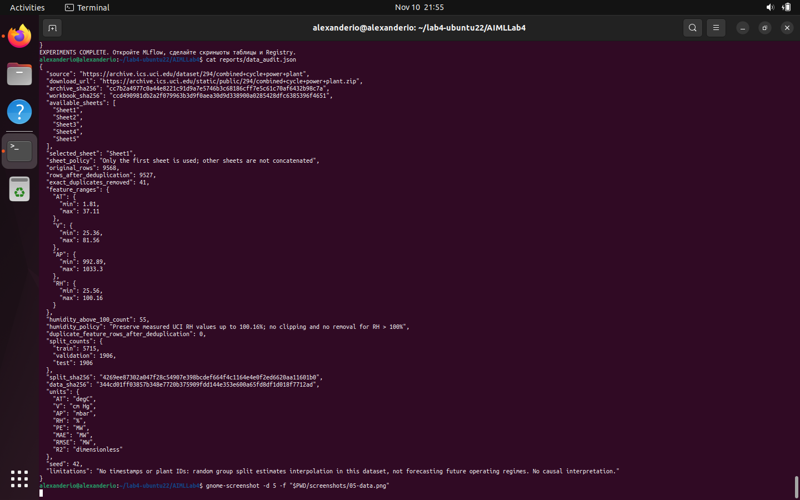

**Рисунок 1 — аудит данных: один лист, 41 дубликат, RH и разбиение.**

Получены **5715 / 1906 / 1906** наблюдений. Индексы зафиксированы в
`data/split.json`, сами части — в CSV. Автоматическая проверка в разделе 13
повторяет split с seed=42 и проверяет отсутствие общих row_id и векторов X.
В датасете нет доступных временных меток: такое разбиение оценивает прогноз по
параметрам среды в рамках данного набора, а не качество прогноза будущих лет.

### 4. Программное окружение и структура проекта

Выполнение проведено в виртуальной машине **Ubuntu 22.04.5 LTS, aarch64**
на Mac M1. В отличие от эталонной Ubuntu 24.04 из методички, системный Python
здесь 3.10.12. Для проекта отдельно установлен **CPython 3.12.14** через
`uv==0.13.5`; системный интерпретатор сохранён. Ядро Linux —
`5.15.0-203-generic`, glibc 2.35. Docker Engine — **29.9.3**, Compose — **v5.7.0**
(фактически записанные версии, не номера из облачной проверки стартового комплекта).

```python
table(["Компонент", "Версия в Ubuntu"], [[name, version] for name, version in environment["packages"].items()])
figure("screenshots/01-system.png", "Рисунок 2 — Ubuntu 22.04.5, ARM64 и исходный системный Python 3.10.12.")
figure("screenshots/02-docker.png", "Рисунок 3 — Docker Engine 29.9.3 и Docker Compose v5.7.0 на ARM64.")
figure("screenshots/03-install.png", "Рисунок 4 — установка зависимостей, pip check и 14 исходных тестов.")
figure("screenshots/04-python.png", "Рисунок 5 — отдельный Python 3.12.14 проекта и сохранённый Python 3.10.12.")
```

| Компонент | Версия в Ubuntu |
|---|---|
| mlflow | 3.5.0 |
| scikit-learn | 1.7.2 |
| pandas | 2.3.3 |
| numpy | 2.2.6 |
| fastapi | 0.119.0 |
| uvicorn | 0.37.0 |
| openpyxl | 3.1.5 |

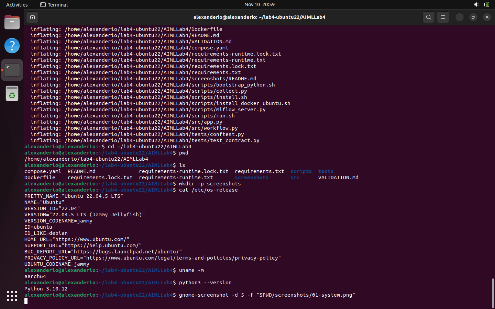

**Рисунок 2 — Ubuntu 22.04.5, ARM64 и исходный системный Python 3.10.12.**

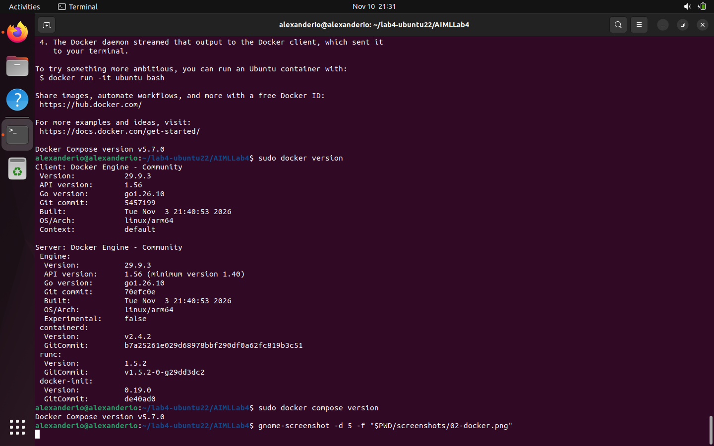

**Рисунок 3 — Docker Engine 29.9.3 и Docker Compose v5.7.0 на ARM64.**

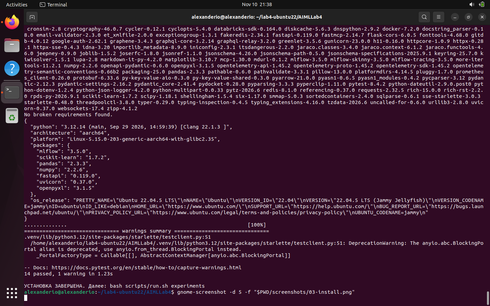

**Рисунок 4 — установка зависимостей, pip check и 14 исходных тестов.**

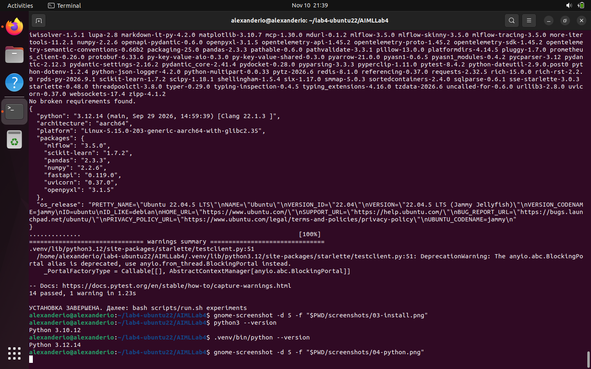

**Рисунок 5 — отдельный Python 3.12.14 проекта и сохранённый Python 3.10.12.**

Скриншоты показывают исходную установку, поэтому на них **14 passed**.
После исправления обработки RH были добавлены три регрессионные проверки
(17 тестов); при подготовке отчёта добавлены проверки численного сравнения
ответов сборщика, и текущая тестовая версия содержит 25 тестов. Эти более
поздние проверки не выдаются за первоначальный запуск на Ubuntu.
`requirements.lock.txt` фиксирует 139 пакетов; отдельный runtime lock содержит
22 зависимости сервиса. `reports/installed-requirements.txt` сохраняет снимок Ubuntu.

```text
AIMLLab4/
  lab4.ipynb, report.md, report.html   # отчёт и версии для просмотра
  requirements*.txt                  # прямые зависимости и lock-файлы
  Dockerfile, compose.yaml, .dockerignore
  src/workflow.py                    # данные, 6 run, Registry, test, export, check
  src/app.py                         # FastAPI, схема входа, загрузка модели
  src/evidence.py                    # численное сравнение ответов сборщика
  scripts/                          # установка, MLflow, этапы и проверки
  tests/                            # тесты API, разбиения, данных, сравнения
  data/raw/                         # исходные ZIP и XLSX
  data/processed/, data/split.json   # очищенная таблица и train/validation/test
  exported_models/v1/, v2/           # metadata, запросы и эталонные прогнозы
  reports/                          # метрики, run_id, JSON-проверки и логи
  screenshots/                      # 14 оригинальных снимков Ubuntu
```

При выполнении также создаются `.venv`, `.tools`, `mlflow-data` и бинарные
`model.joblib`. Они не включены в Git. Переданный архив результатов содержит
метаданные моделей, но не сами joblib и не SQLite MLflow. Их резервная копия
`AIMLLab4-mlflow-backup.tar.gz` сохранена отдельно у исполнителя.

### 5. Последовательность выполнения с командами

Команды ниже описывают **выполненный в Ubuntu** процесс; notebook не запускает их.
Терминал находился в `~/lab4-ubuntu22/AIMLLab4`.

```bash
sudo apt update
sudo apt install -y curl unzip git ca-certificates python3-venv python3-pip gnome-screenshot
bash scripts/install_docker_ubuntu.sh
bash scripts/install.sh
python3 --version
.venv/bin/python --version
bash scripts/run.sh experiments
```

Стартовый комплект распакован с GitHub. MLflow запущен скриптом на
`127.0.0.1:5000`; SQLite хранит метаданные, `mlflow-data/artifacts` — файлы моделей.
Проверка `/health` подтверждает готовность перед логированием.
После исправления диапазона RH команда experiments использовала уже скачанный
исходный архив. Ошибка подготовки не была результатом обучения и не добавляла
успешных run в таблицу.

Далее последовательно выполнены:

```bash
sudo -v
bash scripts/run.sh v1
bash scripts/run.sh v2
bash scripts/run.sh rollback
bash scripts/run.sh compose
# После сохранения скриншотов:
bash scripts/run.sh collect
```

Каждый этап пишет `reports/logs/<этап>.log`. Образ v1 построен для Ridge,
v2 — для выбранного RF; откат использует уже построенный v1. В конце Compose
и MLflow остановлены сборщиком перед резервным копированием. Сборка/запуск,
проверки и результаты подробно разобраны ниже.

### 6. Сравнение шести экспериментов

Experiment: **`lab4-ccpp-variant17`**. Все модели используют один train и один
validation. Ridge проверяется при `alpha=0.1, 1, 10`; RF — с разным количеством
деревьев, глубиной и минимальным числом наблюдений в листе. RF имеет
`random_state=42`, `n_jobs=2`; Ridge использует StandardScaler.

Используются следующие метрики (n — число наблюдений, yᵢ — фактическая
мощность, ŷᵢ — прогноз, ȳ — среднее фактических значений):

- **MAE = (1/n) Σᵢ |yᵢ − ŷᵢ|**, МВт — основной критерий, меньше лучше.
- **RMSE = √[(1/n) Σᵢ (yᵢ − ŷᵢ)²]**, МВт — сильнее реагирует на большие ошибки.
- **R² = 1 − [Σᵢ (yᵢ − ŷᵢ)²] / [Σᵢ (yᵢ − ȳ)²]**, безразмерная — больше лучше.

R² не является accuracy. Формулы записаны текстом и читаются без внешнего MathJax.

Параметры и размеры выборок логируются как params; `val_mae`, `val_rmse`,
`val_r2`, `fit_seconds` — как metrics. Теги включают вариант 17, цель PE,
`selection_metric=val_mae`, направление minimize, единицы и SHA-256 данных/split.
Артефакты — Pipeline с signature и input_example, график validation, `units.json`,
аудит, split, код и зависимости. Dataset input логируется в контексте training.

```python
ordered = sorted(runs, key=lambda row: (row["val_mae"], row["name"]))
table(["Запуск / алгоритм", "Гиперпараметры", "MAE, МВт", "RMSE, МВт", "R²", "fit, с", "run_id"], [
    [r["name"] + " / " + r["algorithm"], json.dumps(r["parameters"], ensure_ascii=False),
     f"{r['val_mae']:.6f}", f"{r['val_rmse']:.6f}", f"{r['val_r2']:.6f}", f"{r['fit_seconds']:.6f}", "`" + r["run_id"] + "`"]
    for r in ordered
])
figure("screenshots/07-mlflow-runs.png", "Рисунок 6 — шесть успешных run и метрики validation в MLflow.")
figure("reports/experiment_comparison.png", "Рисунок 7 — сравнение validation MAE, меньшая ошибка предпочтительна.")
```

| Запуск / алгоритм | Гиперпараметры | MAE, МВт | RMSE, МВт | R² | fit, с | run_id |
|---|---|---|---|---|---|---|
| rf-unlimited / RandomForestRegressor | {"n_estimators": 250, "max_depth": null, "min_samples_leaf": 1} | 2.472198 | 3.505922 | 0.957505 | 1.850220 | `503b388935b047bca0fa775e9603e454` |
| rf-depth16 / RandomForestRegressor | {"n_estimators": 200, "max_depth": 16, "min_samples_leaf": 1} | 2.481119 | 3.519684 | 0.957171 | 1.440665 | `6eb89e3c06d9431f9817f48b1d58534c` |
| rf-depth8 / RandomForestRegressor | {"n_estimators": 120, "max_depth": 8, "min_samples_leaf": 2} | 2.822423 | 3.821705 | 0.949505 | 0.509683 | `7212c64900c94021ba97b8e9f30bb03a` |
| ridge-a0.1 / Ridge | {"alpha": 0.1} | 3.644305 | 4.615727 | 0.926343 | 0.002347 | `22d806e000234fa38084837219197507` |
| ridge-a1 / Ridge | {"alpha": 1.0} | 3.644376 | 4.615542 | 0.926349 | 0.001539 | `dd543db77aad4d3ab65733ae84a3cf55` |
| ridge-a10 / Ridge | {"alpha": 10.0} | 3.645504 | 4.614012 | 0.926398 | 0.001571 | `2cf61299359c42d596a98c3ee8f0c3da` |

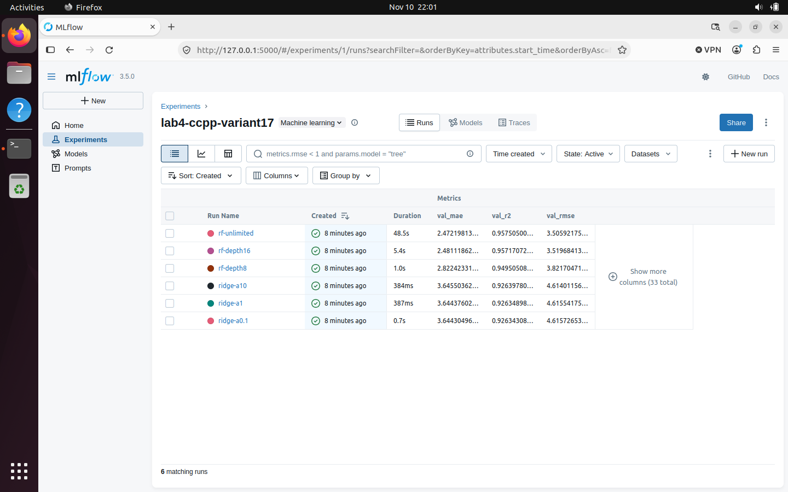

**Рисунок 6 — шесть успешных run и метрики validation в MLflow.**

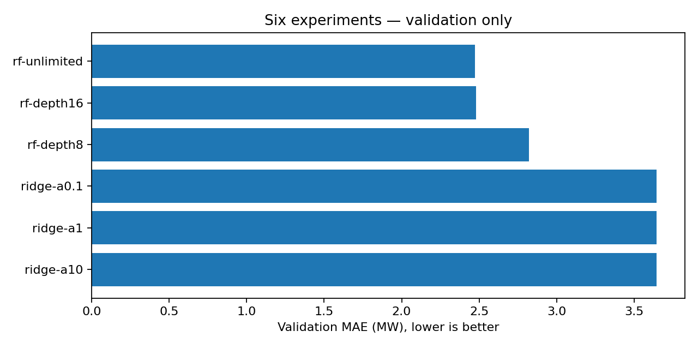

**Рисунок 7 — сравнение validation MAE, меньшая ошибка предпочтительна.**

Лучший результат — **rf-unlimited**, MAE **2,472198 МВт**.
Ridge почти не меняет ошибку при изменении alpha; глубина 8 ограничивает качество
RF. `fit_seconds` — время только `fit`, а Duration в MLflow дополнительно включает
логирование и сериализацию. Поэтому 48,5 с на скриншоте run не равны 1,8502 с
обучения из таблицы. Значения получены на конкретной виртуальной машине и не
являются сравнением производительности на других компьютерах.

### 7. Обоснование выбора и итоговая оценка

Выбран **RandomForestRegressor, 250 деревьев, max_depth=None,
min_samples_leaf=1**. Validation MAE ниже лучшего Ridge примерно на **32,16%**.
Разница с RF depth16 небольшая — **0,008920 МВт** (около 0,36%); по заранее
зафиксированному правилу минимума MAE победителем становится rf-unlimited.
Статистическая значимость такого малого отрыва не исследовалась.

Test не используется для выбора алгоритма/гиперпараметров и не определяет alias.
Итоговая оценка проведена для сохранённой версии 2, без переобучения. Test-метрики
дописаны в исходный run победителя `503b388935b047bca0fa775e9603e454`.

```python
from sklearn.metrics import mean_absolute_error, mean_squared_error, r2_score
predictions = pd.read_csv(ROOT / "reports/test_predictions.csv")
y, yhat = predictions["actual_PE_MW"], predictions["predicted_PE_MW"]
recomputed = {
    "test_mae": float(mean_absolute_error(y, yhat)),
    "test_rmse": float(np.sqrt(mean_squared_error(y, yhat))),
    "test_r2": float(r2_score(y, yhat)),
}
for key in recomputed:
    assert np.isclose(recomputed[key], test[key], rtol=0, atol=1e-12)
table(["Объект", "Значение"], [
    ["Registry version", test["model_version"]], ["Run ID", "`" + test["run_id"] + "`"],
    ["Test, строк", test["n_test"]], ["MAE, МВт", f"{test['test_mae']:.9f}"],
    ["RMSE, МВт", f"{test['test_rmse']:.9f}"], ["R²", f"{test['test_r2']:.9f}"],
])
figure("screenshots/06-test.png", "Рисунок 8 — итоговые test-метрики в терминале Ubuntu.")
figure("reports/test_residuals.png", "Рисунок 9 — распределение остатков выбранной модели на test.")
```

| Объект | Значение |
|---|---|
| Registry version | 2 |
| Run ID | `503b388935b047bca0fa775e9603e454` |
| Test, строк | 1906 |
| MAE, МВт | 2.490805435 |
| RMSE, МВт | 3.601665808 |
| R² | 0.956215210 |

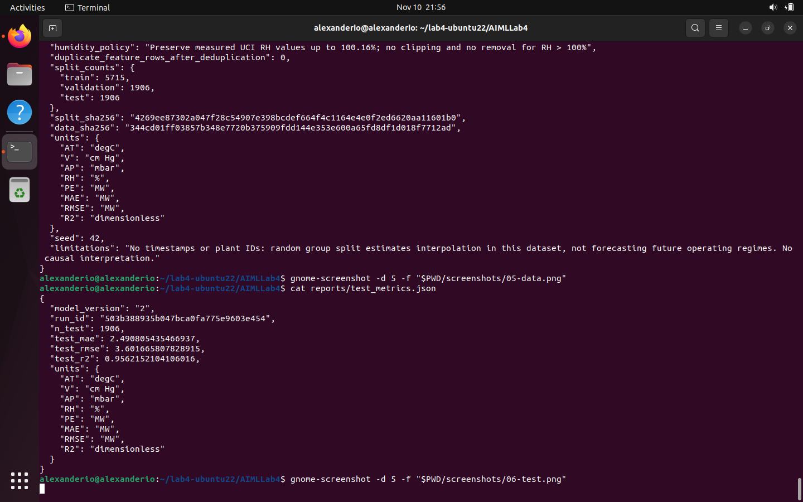

**Рисунок 8 — итоговые test-метрики в терминале Ubuntu.**

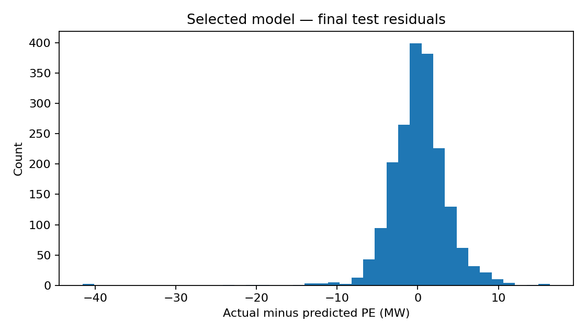

**Рисунок 9 — распределение остатков выбранной модели на test.**

Повторный расчёт по сохранённым 1906 парам «истина–прогноз» подтверждает
**MAE 2,490805 МВт, RMSE 3,601666 МВт, R² 0,956215**. Test MAE близка к validation
MAE 2,472198 МВт. Превышение RMSE над MAE указывает на влияние более крупных
ошибок; их наличие видно на гистограмме. R² характеризует долю объяснённой
вариации на данном test и не означает «95,6% точных ответов».

### 8. Регистрация версий и alias champion

В Model Registry создана одна модель **`ccpp-power`**. Версия 1 — лучший запуск
другого алгоритма, Ridge; версия 2 — выбранный RF. Теги версий содержат роль
baseline/selected и единицу цели MW. Каждая версия связана с исходным run и
URI логированной модели MLflow 3.

```python
table(["Роль", "Registry version", "Запуск", "run_id", "model_uri"], [
    [role, item["model_version"], item["name"], "`" + item["run_id"] + "`", "`" + item["model_uri"] + "`"]
    for role, item in registry["versions"].items()
])
figure("screenshots/08-registry.png", "Рисунок 10 — две версии ccpp-power; champion назначен версии 2.")
```

| Роль | Registry version | Запуск | run_id | model_uri |
|---|---|---|---|---|
| baseline | 1 | ridge-a0.1 | `22d806e000234fa38084837219197507` | `models:/m-ed27e4110ed647dcb8efcaf00f7bbe8e` |
| selected | 2 | rf-unlimited | `503b388935b047bca0fa775e9603e454` | `models:/m-7a02a502abe74b62b1bd4704453e6475` |

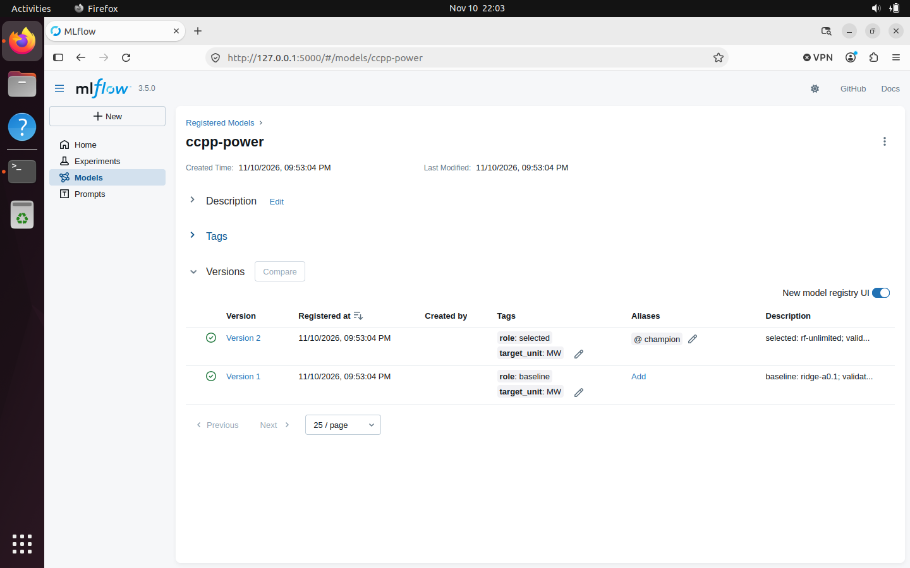

**Рисунок 10 — две версии ccpp-power; champion назначен версии 2.**

На скриншоте после экспериментов alias **champion → version 2**.
При демонстрации v1 он временно назначается версии 1, при обновлении — 2,
при откате — 1, после Compose — снова 2. Последнее назначение также зафиксировано
строкой `champion -> 2` в `reports/logs/compose.log`.
Run ID, номер Registry, тег Docker и image ID — разные идентификаторы.

### 9. Экспорт модели и контракт API

Экспорт читает `models:/ccpp-power@champion`, сохраняет sklearn Pipeline
в `model.joblib`, вычисляет SHA-256 и создаёт `metadata.json`, `sample_request.json`,
`expected_predictions.json`. В v1 StandardScaler поставляется вместе с Ridge;
v2 содержит Pipeline с passthrough и RF. Контейнер использует конкретный экспорт,
не обращаясь к MLflow во время предсказания. Смена alias требует нового экспорта
и сборки для доставки нового снимка.

FastAPI загружает модель при старте и проверяет хеш. При повреждении файла
приложение не проходит запуск. `/health` возвращает готовность загруженной модели,
`/metadata` — её версию, run_id, признаки, единицы и хеш, `/docs` — Swagger UI.

| Метод и путь | Назначение |
|---|---|
| GET `/health` | status и model_version |
| GET `/metadata` | Метаданные конкретного экспорта |
| POST `/predict` | Пакет предсказаний в MW |
| GET `/docs` | Интерактивная документация |

Вход — JSON с единственным верхним ключом `instances`, от 1 до 1000 объектов.
В каждом ровно `AT`, `V`, `AP`, `RH`; конечные JSON-числа, не числовые строки и
не bool. V и AP > 0, RH от 0 до 100,16% с учётом измерений источника.
Лишние/пропущенные поля запрещены. Эти проверки не являются полноценным
контролем сдвига распределения: например, диапазон AT не ограничен наблюдённым
минимумом/максимумом.

Пример фактически выполненного вручную запроса из Swagger:

```json
{"instances": [{"AT": 20.0, "V": 50.0, "AP": 1010.0, "RH": 70.0}]}
```

Ответ HTTP 200:

```json
{"model_version": "2", "predictions_MW": [454.9589200000001], "unit": "MW"}
```

Это другая входная строка, чем пакет из трёх validation-наблюдений в
автоматическом smoke-test. Их прогнозы не должны совпадать между собой.

```python
api = {phase: read_json(f"reports/api_{phase}.json") for phase in ["v1", "v2", "rollback", "compose"]}
table(["Экспорт", "Registry version", "SHA-256 model.joblib (из метаданных)"], [
    [label, read_json(f"exported_models/{label}/metadata.json")["model_version"], "`" + read_json(f"exported_models/{label}/metadata.json")["model_sha256"] + "`"]
    for label in ["v1", "v2"]
])
case_labels = {
    "empty_batch": "Пустой instances", "missing_feature": "Нет обязательного признака",
    "numeric_string": "Число передано строкой", "extra_feature": "Лишнее поле PE",
    "invalid_humidity": "RH=101, вне контракта", "wrong_body": "data вместо instances",
    "too_many_rows": "Больше 1000 строк", "nonfinite_input": "NaN в AT",
}
table(["Проверка", "Ожидается", "Факт v1", "Факт v2", "Факт откат", "Факт Compose"], [
    [case_labels[item["case"]], 422] + [next(c["actual_status"] for c in api[phase]["invalid_requests"] if c["case"] == item["case"]) for phase in api]
    for item in api["v1"]["invalid_requests"]
])
figure("screenshots/13-api-correct.png", "Рисунок 11 — корректный ручной запрос: HTTP 200, версия 2, прогноз 454,95892 МВт.")
figure("screenshots/14-api-invalid.png", "Рисунок 12 — без RH: HTTP 422, Field required с указанием отсутствующего поля.")
```

| Экспорт | Registry version | SHA-256 model.joblib (из метаданных) |
|---|---|---|
| v1 | 1 | `b919f6c15cafc8cd02a217d6c66d781524dc80786e6b56cec178307ba3d25119` |
| v2 | 2 | `447950cc0d8ba2364dc468e69737187757028c02763930c69312881637abf61b` |

| Проверка | Ожидается | Факт v1 | Факт v2 | Факт откат | Факт Compose |
|---|---|---|---|---|---|
| Пустой instances | 422 | 422 | 422 | 422 | 422 |
| Нет обязательного признака | 422 | 422 | 422 | 422 | 422 |
| Число передано строкой | 422 | 422 | 422 | 422 | 422 |
| Лишнее поле PE | 422 | 422 | 422 | 422 | 422 |
| RH=101, вне контракта | 422 | 422 | 422 | 422 | 422 |
| data вместо instances | 422 | 422 | 422 | 422 | 422 |
| Больше 1000 строк | 422 | 422 | 422 | 422 | 422 |
| NaN в AT | 422 | 422 | 422 | 422 | 422 |

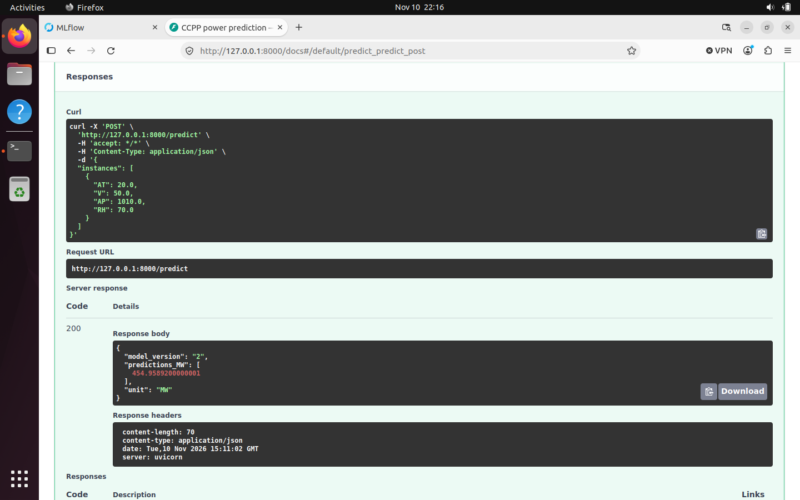

**Рисунок 11 — корректный ручной запрос: HTTP 200, версия 2, прогноз 454,95892 МВт.**

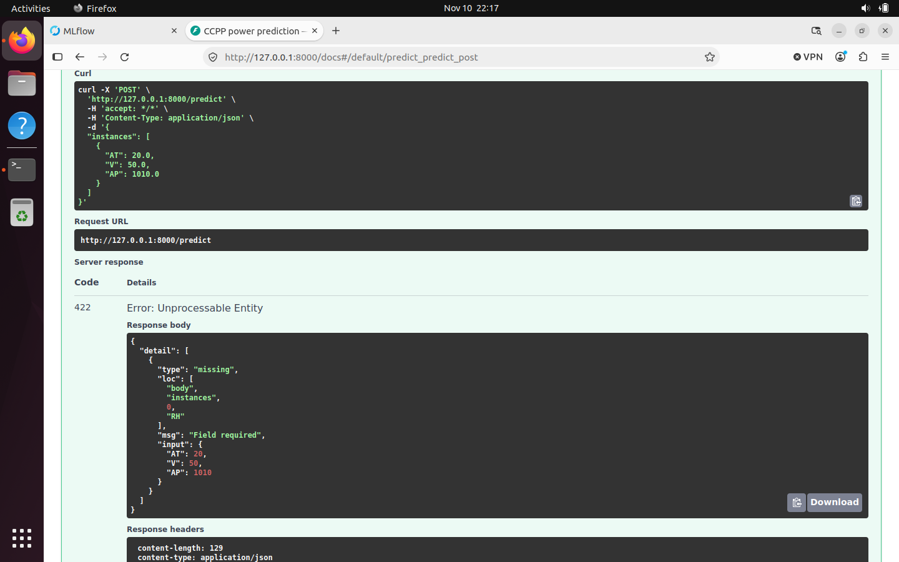

**Рисунок 12 — без RH: HTTP 422, Field required с указанием отсутствующего поля.**

Все восемь автоматических отрицательных сценариев получили 422 на каждом
из четырёх этапов. Отдельный ручной запрос без RH также отклонён с указанием
поля. NaN технически не входит в стандарт JSON; поскольку некоторые парсеры его
допускают, приложение отдельно запрещает нечисловые/бесконечные значения и
возвращает корректный JSON ошибки вместо 500.

### 10. Dockerfile, сборка и совпадение предсказаний

Базовый образ — мультиархитектурный `python:3.12-slim`; при первом запуске
сохранён его RepoDigest. Обе сборки используют этот digest, а не независимо
разрешают изменяемый тег. Итоговые образы имеют архитектуру **linux/arm64**.
Runtime-зависимости фиксируются `requirements-runtime.lock.txt`; образ содержит
`src/app.py` и один конкретный экспорт. Приложение работает от `appuser`,
Uvicorn слушает `0.0.0.0:8000` внутри контейнера. Публикация
`127.0.0.1:8000:8000` ограничивает доступ интерфейсом loopback хоста.

Скрипт `bash scripts/run.sh v1` выполняет эквивалент последовательности:

```bash
.venv/bin/python src/workflow.py export --role baseline --label v1
docker build --build-arg BASE_IMAGE="$(cat reports/base-image.txt)" \
  --build-arg MODEL_PATH=exported_models/v1 -t ccpp-api:v1 .
docker run -d --name ccpp-lab17-api --label lab=ccpp-17 \
  -p 127.0.0.1:8000:8000 ccpp-api:v1
.venv/bin/python src/workflow.py check --label v1 --phase v1
```

При необходимости Docker вызывается через sudo самим скриптом. BuildKit secret
`proxy_ca` опционален для сред с собственным доверенным CA; в Ubuntu проверка TLS
не отключалась. `.dockerignore` исключает данные, MLflow, .venv и прочие ненужные
файлы из контекста, оставляя runtime lock, app и экспорт.

```python
print("Зафиксированный базовый образ:")
print((ROOT / "reports/base-image.txt").read_text().strip())
containers = {phase: read_json(f"reports/container_{phase}.json") for phase in api}
table(["Этап", "Registry version", "Docker tag", "Архитектура", "Image ID"], [
    [phase, api[phase]["model_version"], containers[phase]["image_tag"], "linux/arm64", "`" + containers[phase]["image_id"] + "`"]
    for phase in api
])
table(["Этап", "API против локального экспорта: max |Δ|, МВт", "Допуск"], [
    [phase, f"{api[phase]['max_abs_difference_MW']:.6g}", "rtol=1e-10, atol=1e-9 МВт"] for phase in api
])
figure("screenshots/09-v1.png", "Рисунок 13 — сборка v1, HTTP 200, отрицательные запросы и Docker healthy.")
```

```text
Зафиксированный базовый образ:
python@sha256:5e2bdb1b0d542d5039cffb8181c65930093949194a65c365dfb1b0fe13a4fa5b
```

| Этап | Registry version | Docker tag | Архитектура | Image ID |
|---|---|---|---|---|
| v1 | 1 | ccpp-api:v1 | linux/arm64 | `sha256:5ad83f412ed49351b1c4fc9e0c0e137041782b93e925b4b6b2bc09fdaa95bbbd` |
| v2 | 2 | ccpp-api:v2 | linux/arm64 | `sha256:e58f35cdca769d8147a61f5c9fcd7fe1ba4d7ca6ad7aa67c07f37681fecebb9b` |
| rollback | 1 | ccpp-api:v1 | linux/arm64 | `sha256:5ad83f412ed49351b1c4fc9e0c0e137041782b93e925b4b6b2bc09fdaa95bbbd` |
| compose | 2 | ccpp-api:v2 | linux/arm64 | `sha256:e58f35cdca769d8147a61f5c9fcd7fe1ba4d7ca6ad7aa67c07f37681fecebb9b` |

| Этап | API против локального экспорта: max \|Δ\|, МВт | Допуск |
|---|---|---|
| v1 | 0 | rtol=1e-10, atol=1e-9 МВт |
| v2 | 0 | rtol=1e-10, atol=1e-9 МВт |
| rollback | 0 | rtol=1e-10, atol=1e-9 МВт |
| compose | 5.68434e-14 | rtol=1e-10, atol=1e-9 МВт |

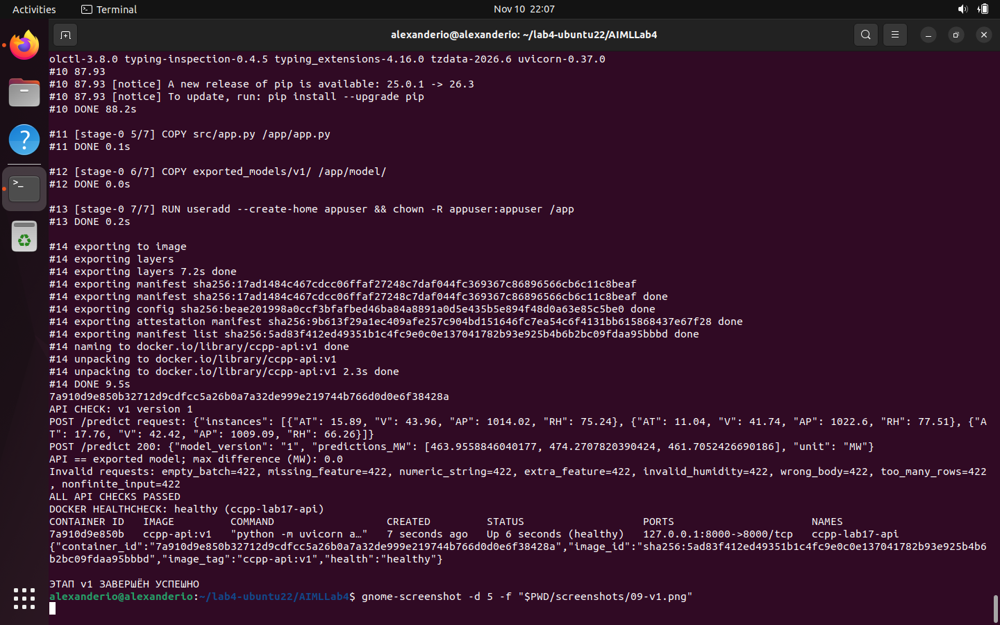

**Рисунок 13 — сборка v1, HTTP 200, отрицательные запросы и Docker healthy.**

Проверка в Ubuntu загрузила экспортированный Pipeline локально и
сравнила его прогнозы с API через `np.testing.assert_allclose`. У v1, v2 и
отката сохранённое максимальное отклонение равно 0; у Compose —
**5,68434×10⁻¹⁴ МВт**, что значительно меньше заданного допуска.
Один PID или открытый порт не использовались как достаточное подтверждение:
выполнялись запросы, проверка версии/метаданных, сравнение прогнозов и healthcheck.

### 11. Обновление и откат без повторного обучения

Порядок версий сервиса: **v1 / Registry 1 → v2 / Registry 2 → откат v1 / Registry 1**.
Команда `v2` экспортирует уже обученную выбранную версию, собирает новый образ
и заменяет контейнер. Команда `rollback` только возвращает champion на 1 и
запускает первоначальный образ `ccpp-api:v1`; в её коде нет обучения,
экспорта или сборки.

```bash
bash scripts/run.sh v2
bash scripts/run.sh rollback
```

Для одного и того же входного пакета записаны следующие прогнозы:

```python
table(["Этап", "Версия", "PE₁, МВт", "PE₂, МВт", "PE₃, МВт"], [
    [phase, api[phase]["model_version"]] + [f"{value:.9f}" for value in api[phase]["valid_response"]["predictions_MW"]]
    for phase in api
])
assert containers["v1"]["image_id"] == containers["rollback"]["image_id"]
assert api["v1"]["model_sha256"] == api["rollback"]["model_sha256"]
np.testing.assert_allclose(api["v1"]["valid_response"]["predictions_MW"], api["rollback"]["valid_response"]["predictions_MW"], rtol=1e-10, atol=1e-9)
print("Откат подтверждён: тот же image ID, хеш модели и прогнозы.")
figure("screenshots/10-v2.png", "Рисунок 14 — обновление до v2: другая версия, другой образ и изменённые прогнозы.")
figure("screenshots/11-rollback.png", "Рисунок 15 — возврат к исходному v1 без обучения и сборки, healthy.")
```

| Этап | Версия | PE₁, МВт | PE₂, МВт | PE₃, МВт |
|---|---|---|---|---|
| v1 | 1 | 463.955884604 | 474.270782039 | 461.705242669 |
| v2 | 2 | 465.653520000 | 475.094240000 | 461.404760000 |
| rollback | 1 | 463.955884604 | 474.270782039 | 461.705242669 |
| compose | 2 | 465.653520000 | 475.094240000 | 461.404760000 |

```text
Откат подтверждён: тот же image ID, хеш модели и прогнозы.
```

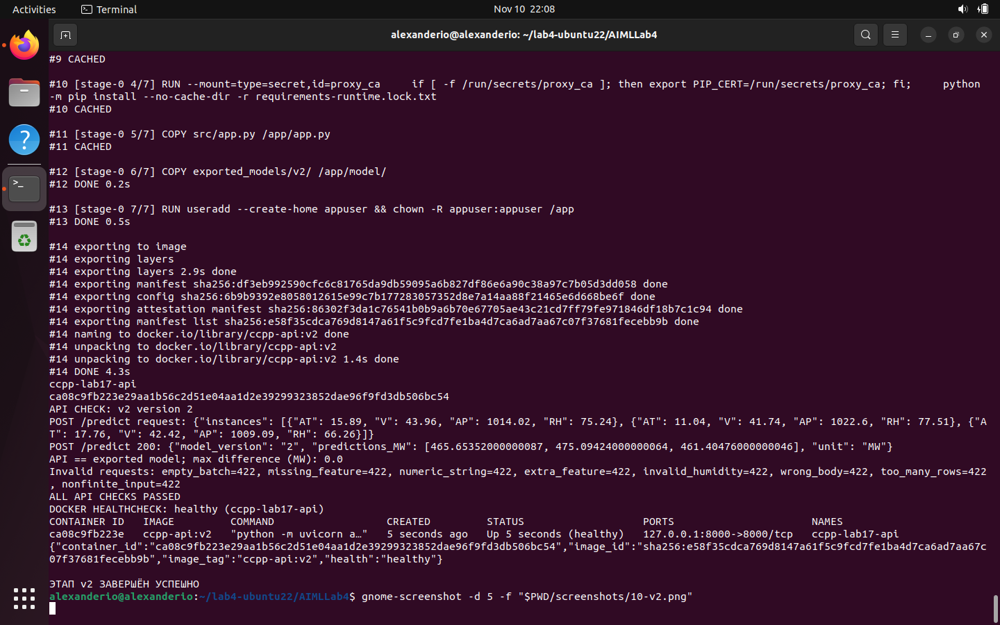

**Рисунок 14 — обновление до v2: другая версия, другой образ и изменённые прогнозы.**

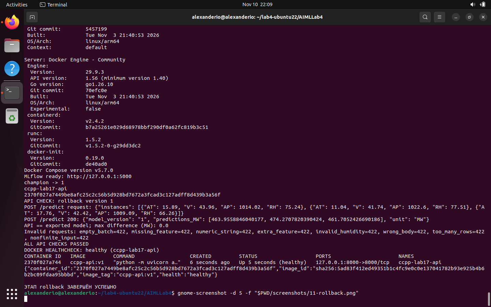

**Рисунок 15 — возврат к исходному v1 без обучения и сборки, healthy.**

В v1 первый прогноз **463,955885 МВт**, в v2 — **465,653520 МВт**;
после отката снова **463,955885 МВт**. У контейнеров до и после отката разные
container ID, поскольку это новые экземпляры, но один и тот же image ID
`sha256:5ad83f412ed49351b1c4fc9e0c0e137041782b93e925b4b6b2bc09fdaa95bbbd`.
Это подтверждает повторное использование исходного образа, а не переобучение
модели под прежним именем. Теги v1/v2 различны; image ID записаны полностью,
так как один и тот же тег технически можно перезаписать.

### 12. Docker Compose и healthcheck

`compose.yaml` запускает уже собранный `ccpp-api:v2`, без повторной сборки.
`pull_policy: never` использует локальный образ; порт — `127.0.0.1:8000:8000`,
`restart: unless-stopped`. Проверка здоровья обращается к `/health` через
стандартный `urllib.request` Python: interval=5s, timeout=3s, start_period=20s,
retries=12. Сначала сервер загружает и проверяет модель, затем отвечает healthy.

```bash
bash scripts/run.sh compose
# Внутри этапа:
docker compose -p ccpp-lab17 up -d --wait --wait-timeout 120
docker compose -p ccpp-lab17 ps
```

Одиночный контейнер лабораторной освобождает порт перед Compose. Alias снова
назначается версии 2. После `--wait` отдельно проверяются API и `.State.Health`.

```python
table(["Этап", "Статус Docker healthcheck", "Проверка API"], [
    [phase, read_json(f"reports/health_{phase}.json")["Status"], api[phase]["all_checks_passed"]] for phase in api
])
assert containers["compose"]["image_id"] == containers["v2"]["image_id"]
print("Compose использует тот же образ v2:", containers["compose"]["image_id"])
figure("screenshots/12-compose.png", "Рисунок 16 — Compose up --wait, сервис healthy и успешные API-проверки.")
```

| Этап | Статус Docker healthcheck | Проверка API |
|---|---|---|
| v1 | healthy | True |
| v2 | healthy | True |
| rollback | healthy | True |
| compose | healthy | True |

```text
Compose использует тот же образ v2: sha256:e58f35cdca769d8147a61f5c9fcd7fe1ba4d7ca6ad7aa67c07f37681fecebb9b
```

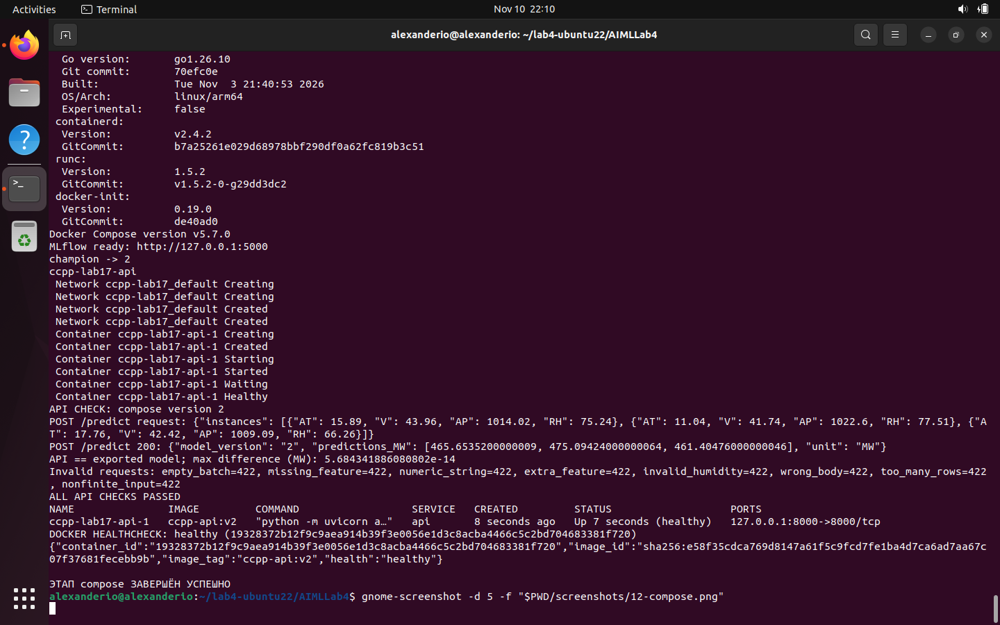

**Рисунок 16 — Compose up --wait, сервис healthy и успешные API-проверки.**

Все четыре этапа имеют статус **healthy**; Compose запустил ту же
версию модели и тот же image ID, что отдельный контейнер v2. HTTP-проверка
включает реальное предсказание и отрицательные сценарии. После сохранения
доказательств `collect` останавливает процессы и создаёт резервную копию MLflow;
наличие скриншота не означает, что сервис продолжает работать после остановки.

### 13. Воспроизводимость и независимая проверка артефактов

В Git включены исходные ZIP/XLSX, очищенная таблица, три части CSV, индексы,
seed=42, прямые зависимости и оба lock-файла, исходники и исходные логи.
Исходный архив результатов имеет SHA-256 в `reports/submission_manifest.json`;
там же зафиксированы хеши всех 94 полученных файлов. Оригинальные данные,
метрики, API-ответы и скриншоты не исправлялись при оформлении отчёта.

Для нового воспроизведения установки и обучения используйте новую копию проекта:
обучение создаст другие run_id и может дать последние биты float иначе на другой
архитектуре. Публикация отчёта сама по себе не восстанавливает исходный Registry:
его SQLite и бинарные модели остались в отдельной резервной копии Ubuntu.

Для просмотра и проверки уже полученных результатов обучение не нужно:

```bash
.venv/bin/python scripts/validate_artifacts.py
.venv/bin/python -m pip install -r requirements-report.txt
.venv/bin/python scripts/run_notebook.py
```

**Разбор одного отрицательного флага сборщика.** В оригинальном
`reports/evidence_status.json` сохранены `update_verified: false` и
`all_checks_passed: false`. Причина — сравнение словарей ответов через точное `==`.
В v2 первая оценка равна `465.65352000000087`, в Compose —
`465.6535200000009`: разница **5,684341886080802×10⁻¹⁴ МВт**, один шаг float64.
У многопоточного RF порядок суммирования может менять последние биты результата.

Отдельные функциональные проверки на Ubuntu уже использовали `allclose` и прошли.
Повторная проверка ниже также проверяет image ID, номер/хеш модели, входной пакет
и предсказания с исходным допуском. Исходный отрицательный флаг **не заменён на true**;
в `reports/verification.json` сохранён отдельный вывод с объяснением. Для будущих
сборов исправлен только численный компаратор сборщика, его исходный вариант
сохранён как `reports/submitted_collect.py.before`.

```python
verification = runpy.run_path(str(ROOT / "scripts/validate_artifacts.py"))["validate"]()
assert verification["all_checks_passed"]
print("Проверок архива:", len(verification["checks"]))
print("Все проверки архива:", verification["all_checks_passed"])
print("Оригинальный update_verified:", verification["original_collector"]["checks"]["update_verified"])
print("v2 vs Compose: max |Δ|, МВт =", verification["v2_vs_compose_max_abs_difference_MW"])
table(["Файл", "SHA-256"], [
    [name, "`" + hashlib.sha256((ROOT / name).read_bytes()).hexdigest() + "`"]
    for name in ["data/raw/ccpp.zip", "data/raw/Folds5x2_pp.xlsx", "data/processed/data.csv", "data/split.json"]
])
```

```text
Проверок архива: 50
Все проверки архива: True
Оригинальный update_verified: False
v2 vs Compose: max |Δ|, МВт = 5.684341886080802e-14
```

| Файл | SHA-256 |
|---|---|
| data/raw/ccpp.zip | `cc7b2a4977c0a44e8221c91d9a7e5746b3c68186cff7e5c61c70af6432b98c7a` |
| data/raw/Folds5x2_pp.xlsx | `ccd490981db2a2f079963b3d9f0aea30d9d338900a0285428dfc6385396f4651` |
| data/processed/data.csv | `344cd01ff03857b348e7720b375909fdd144e353e600a65fd8df1d018f7712ad` |
| data/split.json | `4269ee87302a047f28c54907e398bcdef664f4c1164e4e0f2ed6620aa11601b0` |

Проверка заново пересчитала test-метрики, восстановила split с seed=42,
проверила отсутствие утечки и неизменность исходных файлов, согласованность
run_id/версий, восемь отрицательных сценариев каждого этапа, образы и healthcheck.
Для API используются сохранённые запросы/ответы: это проверка доказательств,
не повторное обращение к остановленному сервису. Хеши моделей сопоставляются
между метаданными; пересчитать их по бинарным файлам из этого ZIP невозможно,
поскольку joblib в него намеренно не включены.

### 14. Выводы

1. Для варианта 17 использован первый лист CCPP: **9568** исходных наблюдений,
**41** полный дубликат удалён, **9527** строк разделены на **5715/1906/1906**.
Повторные листы не объединялись; RH до 100,16% сохранена как измерение источника.
2. В MLflow проведены **шесть** запусков с параметрами, метриками, тегами,
единицами, графиками, split и Pipeline. По validation MAE выбран RF с 250
деревьями и неограниченной глубиной: **2,472198 МВт**, примерно на **32,16%**
лучше лучшего Ridge в этом сравнении.
3. На отложенном test выбранная модель получила **MAE 2,490805 МВт,
RMSE 3,601666 МВт, R² 0,956215**. Test не участвовал в выборе; значимость малого
отрыва от RF depth16 отдельно не оценивалась.
4. Созданы **две версии Registry**, назначен champion; Pipeline экспортирован
с преобразованиями и метаданными. FastAPI возвращает версии и MW, корректные
запросы проходят с 200, восемь классов ошибок — с 422.
5. Собраны два ARM64 Docker-образа. Сравнение API с локальным экспортом проходит
с заданным допуском. Продемонстрированы обновление **v1→v2** и откат **v2→v1**
без обучения: при откате image ID, хеш модели и прогнозы вернулись к исходным.
6. Compose запустил выбранный v2 с **healthy**, автоматические проверки API
прошли. Обнаруженный строгий компаратор сборщика объясняет ложный отрицательный
флаг: различие одного ULP не является сменой модели или ошибкой развёртывания.
7. Зафиксированы данные, split, seed, зависимости, исходники, логи и 14 снимков.
Результат ограничен данным режимом полной нагрузки и случайным разбиением без
временных меток; он не доказывает качество прогноза будущих режимов и не заменяет
мониторинг дрейфа, CI/CD или производственный контур эксплуатации.

### 15. Список использованных источников

1. **UCI Combined Cycle Power Plant.** [Страница набора](https://archive.ics.uci.edu/dataset/294/combined+cycle+power+plant).
DOI: [10.24432/C5002N](https://doi.org/10.24432/C5002N). Описание и исходный архив.
2. **CCPP/Readme.txt** в исходном ZIP: годы, полная нагрузка, почасовые признаки
и назначение пяти перемешиваний. Архив включён в `data/raw/ccpp.zip`.
3. Tüfekci P. **Prediction of full load electrical power output of a base load
operated combined cycle power plant using machine learning methods.**
International Journal of Electrical Power & Energy Systems. 2014. Vol. 60.
P. 126–140. DOI: [10.1016/j.ijepes.2014.02.027](https://doi.org/10.1016/j.ijepes.2014.02.027).
4. MLflow: [Tracking](https://mlflow.org/docs/latest/self-hosting/architecture/tracking-server/),
[Model Registry](https://mlflow.org/docs/latest/ml/model-registry/),
[sklearn API](https://mlflow.org/docs/latest/api_reference/python_api/mlflow.sklearn.html).
5. scikit-learn: [Ridge](https://scikit-learn.org/stable/modules/generated/sklearn.linear_model.Ridge.html),
[RandomForestRegressor](https://scikit-learn.org/stable/modules/generated/sklearn.ensemble.RandomForestRegressor.html),
[GroupShuffleSplit](https://scikit-learn.org/stable/modules/generated/sklearn.model_selection.GroupShuffleSplit.html),
[Pipeline](https://scikit-learn.org/stable/modules/generated/sklearn.pipeline.Pipeline.html).
6. Docker: [Engine на Ubuntu](https://docs.docker.com/engine/install/ubuntu/),
[Dockerfile](https://docs.docker.com/reference/dockerfile/),
[Compose services / healthcheck](https://docs.docker.com/reference/compose-file/services/#healthcheck).
7. [FastAPI](https://fastapi.tiangolo.com/) и [Pydantic](https://docs.pydantic.dev/latest/).
8. Методические указания **«Лабораторная работа 4. MLOps»**, предоставленный PDF;
индивидуальный вариант 17.
9. [Репозиторий первой лабораторной](https://github.com/Alexanderio1/AIML) — образец
оформления notebook/HTML, а не источник метрик настоящей работы.

### 16. Приложение: исходный код, зависимости и примеры запросов

Полные исполняемые файлы размещены в `src/`, `scripts/`, `tests/`. Ниже приведён
листинг основной программы обучения/экспорта, API, оркестратора, MLflow-сервера,
Dockerfile, Compose и зависимостей. Полные lock-файлы и примеры запросов также
доступны отдельными файлами. Показанный `scripts/collect.py` содержит исправление
компаратора, внесённое после выполнения; первоначальный вариант сохранён отдельно.

```python
listing = [
    ("src/workflow.py", "python"), ("src/app.py", "python"),
    ("scripts/run.sh", "bash"), ("scripts/mlflow_server.py", "python"),
    ("scripts/collect.py", "python"), ("src/evidence.py", "python"),
    ("Dockerfile", "dockerfile"), ("compose.yaml", "yaml"),
    (".dockerignore", "text"), ("requirements.txt", "text"),
    ("requirements-runtime.lock.txt", "text"),
]
for name, language in listing:
    display(Markdown("<details>\n<summary>" + name + " — полный листинг</summary>\n\n```" + language + "\n" + (ROOT / name).read_text().rstrip() + "\n```\n\n</details>"))
print("Фиксированные прямые и транзитивные зависимости: requirements.lock.txt, requirements-runtime.lock.txt")
print("Пример пакета для проверки:")
print((ROOT / "exported_models/v2/sample_request.json").read_text())
print("Эталонные предсказания этого пакета:")
print((ROOT / "exported_models/v2/expected_predictions.json").read_text())
```

<details>
<summary>src/workflow.py — полный листинг</summary>

```python
"""Reproducible CCPP experiment workflow. Run from repository root."""
import argparse
import hashlib
import json
import os
import platform
import sys
import time
import zipfile
from pathlib import Path

import joblib
import matplotlib
matplotlib.use("Agg")
import matplotlib.pyplot as plt
import mlflow
import mlflow.sklearn
import numpy as np
import pandas as pd
import requests
from mlflow import MlflowClient
from mlflow.models import infer_signature
from sklearn.ensemble import RandomForestRegressor
from sklearn.linear_model import Ridge
from sklearn.metrics import mean_absolute_error, mean_squared_error, r2_score
from sklearn.model_selection import GroupShuffleSplit
from sklearn.pipeline import Pipeline
from sklearn.preprocessing import StandardScaler

ROOT = Path(__file__).resolve().parents[1]
os.chdir(ROOT)
FEATURES = ["AT", "V", "AP", "RH"]
TARGET = "PE"
SEED = 42
SOURCE = "https://archive.ics.uci.edu/dataset/294/combined+cycle+power+plant"
DOWNLOAD = "https://archive.ics.uci.edu/static/public/294/combined+cycle+power+plant.zip"
UNITS = {"AT": "degC", "V": "cm Hg", "AP": "mbar", "RH": "%", "PE": "MW", "MAE": "MW", "RMSE": "MW", "R2": "dimensionless"}
EXPERIMENT = "lab4-ccpp-variant17"
MODEL_NAME = "ccpp-power"


def save(path, value):
    path = Path(path)
    path.parent.mkdir(parents=True, exist_ok=True)
    path.write_text(json.dumps(value, ensure_ascii=False, indent=2, allow_nan=False) + "\n")


def read(path):
    return json.loads(Path(path).read_text())


def sha(path):
    return hashlib.sha256(Path(path).read_bytes()).hexdigest()


def connect():
    mlflow.set_tracking_uri(os.getenv("MLFLOW_TRACKING_URI", "http://127.0.0.1:5000"))
    return MlflowClient()


def split_frame(frame):
    """Group identical feature vectors, even if their target values differ."""
    groups = pd.util.hash_pandas_object(frame[FEATURES], index=False).to_numpy()
    first = GroupShuffleSplit(n_splits=1, test_size=.2, random_state=SEED)
    dev, test = next(first.split(frame, groups=groups))
    second = GroupShuffleSplit(n_splits=1, test_size=.25, random_state=SEED)
    train_part, val_part = next(second.split(frame.iloc[dev], groups=groups[dev]))
    indices = {"train": dev[train_part], "validation": dev[val_part], "test": test}
    sets = {key: set(groups[pos]) for key, pos in indices.items()}
    assert sets["train"].isdisjoint(sets["validation"])
    assert sets["train"].isdisjoint(sets["test"])
    assert sets["validation"].isdisjoint(sets["test"])
    assert sum(map(len, indices.values())) == len(frame)
    return indices


def prepare():
    raw = ROOT / "data/raw"
    raw.mkdir(parents=True, exist_ok=True)
    archive = raw / "ccpp.zip"
    if not archive.exists():
        print("Downloading", DOWNLOAD, flush=True)
        response = requests.get(DOWNLOAD, timeout=(20, 180))
        response.raise_for_status()
        temp = archive.with_suffix(".tmp")
        temp.write_bytes(response.content)
        if not zipfile.is_zipfile(temp):
            raise RuntimeError("UCI response is not a ZIP archive")
        temp.replace(archive)
    with zipfile.ZipFile(archive) as z:
        matches = [n for n in z.namelist() if Path(n).name == "Folds5x2_pp.xlsx" and not n.startswith("__MACOSX/")]
        if len(matches) != 1:
            raise RuntimeError(f"Expected exactly one Folds5x2_pp.xlsx, got {matches}")
        workbook = raw / "Folds5x2_pp.xlsx"
        workbook.write_bytes(z.read(matches[0]))
    excel = pd.ExcelFile(workbook, engine="openpyxl")
    selected_sheet = excel.sheet_names[0]
    original = pd.read_excel(excel, sheet_name=selected_sheet)
    if list(original.columns) != FEATURES + [TARGET]:
        raise RuntimeError(f"Unexpected columns: {list(original.columns)}")
    if len(original) != 9568:
        raise RuntimeError(f"UCI first sheet should have 9568 rows, got {len(original)}. Check source.")
    if original.isna().any().any() or not np.isfinite(original.to_numpy(dtype=float)).all():
        raise RuntimeError("Missing or nonfinite data: investigate instead of silently deleting")
    # UCI CCPP contains measured RH values up to 100.16%. Preserve these
    # observations; a theoretical 100% cutoff would reject the source dataset.
    valid = (original.RH >= 0) & (original.RH <= 100.16) & (original.AP > 0) & (original.V > 0)
    if not valid.all():
        examples = original.loc[~valid, FEATURES].head(5).to_dict(orient="records")
        raise RuntimeError(f"Source values violate input constraints (RH 0..100.16%, AP > 0, V > 0): {examples}")
    clean = original.drop_duplicates().copy()
    clean.insert(0, "row_id", clean.index.astype(int))
    clean = clean.reset_index(drop=True)
    (ROOT / "data/processed").mkdir(parents=True, exist_ok=True)
    clean.to_csv("data/processed/data.csv", index=False)
    indices = split_frame(clean)
    split = {key: clean.iloc[pos].row_id.astype(int).tolist() for key, pos in indices.items()}
    for key, pos in indices.items():
        clean.iloc[pos].to_csv(f"data/processed/{key}.csv", index=False)
    split.update({"seed": SEED, "method": "GroupShuffleSplit on identical feature vectors; approximately 60/20/20", "features": FEATURES, "target": TARGET})
    save("data/split.json", split)
    audit = {
        "source": SOURCE, "download_url": DOWNLOAD, "archive_sha256": sha(archive),
        "workbook_sha256": sha(workbook), "available_sheets": excel.sheet_names,
        "selected_sheet": selected_sheet, "sheet_policy": "Only the first sheet is used; other sheets are not concatenated",
        "original_rows": len(original), "rows_after_deduplication": len(clean),
        "exact_duplicates_removed": len(original) - len(clean),
        "feature_ranges": {key: {"min": float(original[key].min()), "max": float(original[key].max())} for key in FEATURES},
        "humidity_above_100_count": int((original.RH > 100).sum()),
        "humidity_policy": "Preserve measured UCI RH values up to 100.16%; no clipping and no removal for RH > 100%",
        "duplicate_feature_rows_after_deduplication": int(clean.duplicated(FEATURES).sum()),
        "split_counts": {key: len(pos) for key, pos in indices.items()},
        "split_sha256": sha("data/split.json"), "data_sha256": sha("data/processed/data.csv"),
        "units": UNITS, "seed": SEED,
        "limitations": "No timestamps or plant IDs: random group split estimates interpolation in this dataset, not forecasting future operating regimes. No causal interpretation.",
    }
    save("reports/data_audit.json", audit)
    print(json.dumps(audit, indent=2, ensure_ascii=False))


def dataset(part):
    data = pd.read_csv(f"data/processed/{part}.csv")
    return data[FEATURES], data[TARGET]


def metrics(y, pred, prefix):
    return {f"{prefix}_mae": float(mean_absolute_error(y, pred)),
            f"{prefix}_rmse": float(np.sqrt(mean_squared_error(y, pred))),
            f"{prefix}_r2": float(r2_score(y, pred))}


def configurations():
    return [
        ("ridge-a0.1", "Ridge", {"alpha": .1}),
        ("ridge-a1", "Ridge", {"alpha": 1.0}),
        ("ridge-a10", "Ridge", {"alpha": 10.0}),
        ("rf-depth8", "RandomForestRegressor", {"n_estimators": 120, "max_depth": 8, "min_samples_leaf": 2}),
        ("rf-depth16", "RandomForestRegressor", {"n_estimators": 200, "max_depth": 16, "min_samples_leaf": 1}),
        ("rf-unlimited", "RandomForestRegressor", {"n_estimators": 250, "max_depth": None, "min_samples_leaf": 1}),
    ]


def make_model(algorithm, params):
    if algorithm == "Ridge":
        return Pipeline([("preprocess", StandardScaler()), ("regressor", Ridge(**params))])
    return Pipeline([("preprocess", "passthrough"), ("regressor", RandomForestRegressor(**params, random_state=SEED, n_jobs=2))])


def train():
    connect()
    mlflow.set_experiment(EXPERIMENT)
    X, y = dataset("train")
    Xval, yval = dataset("validation")
    audit = read("reports/data_audit.json")
    records = []
    for name, algorithm, params in configurations():
        model = make_model(algorithm, params)
        with mlflow.start_run(run_name=name) as run:
            mlflow.log_params({"algorithm": algorithm, **params, "seed": SEED, "dataset": "UCI CCPP first sheet",
                               "n_train": len(X), "n_validation": len(Xval), "n_test": audit["split_counts"]["test"],
                               "preprocessing": "StandardScaler" if algorithm == "Ridge" else "passthrough", "n_jobs": 2 if algorithm != "Ridge" else 1})
            mlflow.set_tags({"variant": "17", "selection_metric": "val_mae", "selection_direction": "minimize",
                             "dataset_sha256": audit["data_sha256"], "split_sha256": audit["split_sha256"],
                             "target": "PE", "target_unit": "MW", "mae_unit": "MW", "rmse_unit": "MW", "feature_units": json.dumps({k: UNITS[k] for k in FEATURES})})
            start = time.perf_counter()
            model.fit(X, y)
            elapsed = time.perf_counter() - start
            pred = model.predict(Xval)
            values = metrics(yval, pred, "val")
            mlflow.log_metrics({**values, "fit_seconds": elapsed})
            mlflow.log_dict(UNITS, "units.json")
            mlflow.log_dict(audit, "data_audit.json")
            mlflow.log_artifact("data/split.json")
            mlflow.log_artifact("requirements.lock.txt", artifact_path="source")
            mlflow.log_artifact(__file__, artifact_path="source")
            mlflow.log_input(mlflow.data.from_pandas(X.assign(PE=y), source=SOURCE, targets="PE"), context="training")
            fig, ax = plt.subplots(figsize=(6, 4))
            ax.scatter(yval, pred, s=5, alpha=.4)
            lo, hi = min(yval.min(), pred.min()), max(yval.max(), pred.max())
            ax.plot([lo, hi], [lo, hi], "r--")
            ax.set(xlabel="Actual PE (MW)", ylabel="Predicted PE (MW)", title=name + " — validation")
            fig.tight_layout()
            fig.savefig(f"reports/validation_{name}.png", dpi=160)
            mlflow.log_figure(fig, "validation_predictions.png")
            plt.close(fig)
            info = mlflow.sklearn.log_model(model, name="model", input_example=X.head(3), signature=infer_signature(X, model.predict(X)),
                                           pip_requirements=Path("requirements.lock.txt").read_text().splitlines())
            record = {"name": name, "algorithm": algorithm, "parameters": params, **values, "fit_seconds": elapsed,
                      "run_id": run.info.run_id, "model_uri": info.model_uri}
            records.append(record)
            print(json.dumps(record), flush=True)
    # Deterministic tie break: lower MAE, then name. Test data are not accessed here.
    records.sort(key=lambda r: (r["val_mae"], r["name"]))
    save("reports/experiments.json", records)
    table = pd.DataFrame([{**r, "parameters": json.dumps(r["parameters"])} for r in records])
    table.to_csv("reports/experiments.csv", index=False)
    fig, ax = plt.subplots(figsize=(8, 4))
    ax.barh(table["name"], table["val_mae"])
    ax.invert_yaxis()
    ax.set(xlabel="Validation MAE (MW), lower is better", title="Six experiments — validation only")
    fig.tight_layout()
    fig.savefig("reports/experiment_comparison.png", dpi=160)
    plt.close(fig)
    print("\nSIX EXPERIMENTS — selection by validation MAE, MW")
    print(table[["name", "algorithm", "val_mae", "val_rmse", "val_r2", "run_id"]].to_string(index=False))


def register():
    client = connect()
    records = read("reports/experiments.json")
    winner = records[0]
    baseline = next(r for r in records if r["algorithm"] != winner["algorithm"])
    versions = {}
    for role, record in [("baseline", baseline), ("selected", winner)]:
        mv = mlflow.register_model(record["model_uri"], MODEL_NAME, await_registration_for=120)
        client.set_model_version_tag(MODEL_NAME, mv.version, "role", role)
        client.set_model_version_tag(MODEL_NAME, mv.version, "target_unit", "MW")
        client.update_model_version(MODEL_NAME, mv.version, description=f"{role}: {record['name']}; validation MAE={record['val_mae']:.6f} MW")
        versions[role] = {**record, "model_version": str(mv.version)}
    client.set_registered_model_alias(MODEL_NAME, "champion", versions["selected"]["model_version"])
    save("reports/registry.json", {"model_name": MODEL_NAME, "alias": "champion", "versions": versions,
                                   "selection_rule": "Minimum validation MAE; baseline is best configuration of the other algorithm. Test excluded from selection."})
    print(json.dumps(read("reports/registry.json"), ensure_ascii=False, indent=2))


def evaluate():
    connect()
    chosen = read("reports/registry.json")["versions"]["selected"]
    model = mlflow.sklearn.load_model(f"models:/{MODEL_NAME}/{chosen['model_version']}")
    Xtest, ytest = dataset("test")
    pred = model.predict(Xtest)
    values = metrics(ytest, pred, "test")
    with mlflow.start_run(run_id=chosen["run_id"]):
        mlflow.log_metrics(values)
        mlflow.set_tag("test_usage", "Final evaluation after validation-only selection; no retraining")
    result = {"model_version": chosen["model_version"], "run_id": chosen["run_id"], "n_test": len(Xtest), **values, "units": UNITS}
    save("reports/test_metrics.json", result)
    pd.DataFrame({"actual_PE_MW": ytest, "predicted_PE_MW": pred}).to_csv("reports/test_predictions.csv", index=False)
    fig, ax = plt.subplots(figsize=(7, 4))
    ax.hist(ytest - pred, bins=40)
    ax.set(xlabel="Actual minus predicted PE (MW)", ylabel="Count", title="Selected model — final test residuals")
    fig.tight_layout()
    fig.savefig("reports/test_residuals.png", dpi=160)
    plt.close(fig)
    print("FINAL TEST (not used for selection)")
    print(json.dumps(result, indent=2))


def export(role, label):
    client = connect()
    selected = read("reports/registry.json")["versions"][role]
    version = selected["model_version"]
    client.set_registered_model_alias(MODEL_NAME, "champion", version)
    alias = client.get_model_version_by_alias(MODEL_NAME, "champion")
    assert str(alias.version) == version
    model = mlflow.sklearn.load_model(f"models:/{MODEL_NAME}@champion")
    root = ROOT / "exported_models" / label
    root.mkdir(parents=True, exist_ok=True)
    joblib.dump(model, root / "model.joblib")
    save(root / "metadata.json", {"model_name": MODEL_NAME, "model_version": version, "run_id": selected["run_id"],
                                 "algorithm": selected["algorithm"], "parameters": selected["parameters"],
                                 "model_sha256": sha(root / "model.joblib"), "features": FEATURES, "target": TARGET,
                                 "units": UNITS, "validation_mae_MW": selected["val_mae"]})
    X, _ = dataset("validation")
    example = X.head(3)
    save(root / "sample_request.json", {"instances": example.to_dict(orient="records")})
    save(root / "expected_predictions.json", {"predictions_MW": model.predict(example).tolist()})
    print("EXPORTED", label, "registry version", version, "alias champion")
    print((root / "metadata.json").read_text())


def check(label, phase):
    root = ROOT / "exported_models" / label
    metadata = read(root / "metadata.json")
    model = joblib.load(root / "model.joblib")
    body = read(root / "sample_request.json")
    expected = model.predict(pd.DataFrame(body["instances"], columns=FEATURES))
    base = "http://127.0.0.1:8000"
    for _ in range(90):
        try:
            response = requests.get(base + "/health", timeout=2)
            if response.status_code == 200:
                break
        except requests.RequestException:
            pass
        time.sleep(1)
    else:
        raise RuntimeError("API did not become healthy in 90 seconds")
    response = requests.get(base + "/metadata", timeout=10)
    response.raise_for_status()
    actual_meta = response.json()
    assert actual_meta == metadata, "Wrong model/image deployed"
    response = requests.post(base + "/predict", json=body, timeout=20)
    response.raise_for_status()
    actual = response.json()
    assert actual["model_version"] == metadata["model_version"]
    np.testing.assert_allclose(actual["predictions_MW"], expected, rtol=1e-10, atol=1e-9)
    requests.get(base + "/docs", timeout=10).raise_for_status()
    cases = []
    invalid = [
        ("empty_batch", {"instances": []}),
        ("missing_feature", {"instances": [{k: v for k, v in body["instances"][0].items() if k != "AT"}]}),
        ("numeric_string", {"instances": [{**body["instances"][0], "AT": "20"}]}),
        ("extra_feature", {"instances": [{**body["instances"][0], "PE": 450.0}]}),
        ("invalid_humidity", {"instances": [{**body["instances"][0], "RH": 101.0}]}),
        ("wrong_body", {"data": body["instances"]}),
        ("too_many_rows", {"instances": body["instances"][:1] * 1001}),
    ]
    for name, bad in invalid:
        r = requests.post(base + "/predict", json=bad, timeout=20)
        assert r.status_code == 422, f"{name}: {r.status_code} {r.text}"
        cases.append({"case": name, "expected_status": 422, "actual_status": r.status_code, "request": bad, "response": r.json()})
    nonfinite = json.dumps({"instances": [{**body["instances"][0], "AT": float("nan")}]})
    r = requests.post(base + "/predict", data=nonfinite, headers={"Content-Type": "application/json"}, timeout=20)
    assert r.status_code == 422, f"nonfinite input: {r.status_code} {r.text}"
    cases.append({"case": "nonfinite_input", "expected_status": 422, "actual_status": r.status_code, "request_raw": nonfinite, "response": r.json()})
    result = {"phase": phase, "model_version": metadata["model_version"], "run_id": metadata["run_id"],
              "model_sha256": metadata["model_sha256"], "valid_request": body, "valid_response": actual,
              "expected_predictions_MW": expected.tolist(), "max_abs_difference_MW": float(np.max(np.abs(np.array(actual["predictions_MW"]) - expected))),
              "invalid_requests": cases, "all_checks_passed": True}
    save(f"reports/api_{phase}.json", result)
    print("API CHECK:", phase, "version", metadata["model_version"])
    print("POST /predict request:", json.dumps(body))
    print("POST /predict 200:", json.dumps(actual))
    print("API == exported model; max difference (MW):", result["max_abs_difference_MW"])
    print("Invalid requests:", ", ".join(c["case"] + "=422" for c in cases))
    print("ALL API CHECKS PASSED")


def environment():
    import importlib.metadata
    packages = {name: importlib.metadata.version(name) for name in ["mlflow", "scikit-learn", "pandas", "numpy", "fastapi", "uvicorn", "openpyxl"]}
    result = {"python": sys.version, "architecture": platform.machine(), "platform": platform.platform(), "packages": packages,
              "os_release": Path("/etc/os-release").read_text() if Path("/etc/os-release").exists() else "unavailable"}
    save("reports/environment.json", result)
    print(json.dumps(result, indent=2))


if __name__ == "__main__":
    p = argparse.ArgumentParser()
    sub = p.add_subparsers(dest="command", required=True)
    for name in ["prepare", "train", "register", "evaluate", "environment"]:
        sub.add_parser(name)
    ex = sub.add_parser("export")
    ex.add_argument("--role", choices=["baseline", "selected"], required=True)
    ex.add_argument("--label", choices=["v1", "v2"], required=True)
    ch = sub.add_parser("check")
    ch.add_argument("--label", choices=["v1", "v2"], required=True)
    ch.add_argument("--phase", choices=["v1", "v2", "rollback", "compose"], required=True)
    args = p.parse_args()
    if args.command == "export":
        export(args.role, args.label)
    elif args.command == "check":
        check(args.label, args.phase)
    else:
        globals()[args.command]()
```

</details>

<details>
<summary>src/app.py — полный листинг</summary>

```python
"""Offline inference: container does not require MLflow or network access."""
import hashlib
import json
import os
from contextlib import asynccontextmanager
from pathlib import Path

import joblib
import pandas as pd
from fastapi import FastAPI
from fastapi.exceptions import RequestValidationError
from fastapi.responses import JSONResponse
from pydantic import BaseModel, ConfigDict, Field

FEATURES = ["AT", "V", "AP", "RH"]


class Instance(BaseModel):
    model_config = ConfigDict(extra="forbid", strict=True, allow_inf_nan=False)
    AT: float = Field(description="Ambient temperature, degrees Celsius")
    V: float = Field(gt=0, description="Exhaust vacuum, cm Hg")
    AP: float = Field(gt=0, description="Ambient pressure, millibar")
    RH: float = Field(ge=0, le=100.16, description="Relative humidity, percent; UCI measured values extend to 100.16")


class PredictionRequest(BaseModel):
    model_config = ConfigDict(extra="forbid", strict=True)
    instances: list[Instance] = Field(min_length=1, max_length=1000)


@asynccontextmanager
async def lifespan(app):
    root = Path(os.getenv("MODEL_DIR", "exported_models/v1"))
    metadata = json.loads((root / "metadata.json").read_text())
    digest = hashlib.sha256((root / "model.joblib").read_bytes()).hexdigest()
    if digest != metadata["model_sha256"]:
        raise RuntimeError("Exported model checksum mismatch")
    app.state.model = joblib.load(root / "model.joblib")
    app.state.metadata = metadata
    yield


app = FastAPI(title="CCPP power prediction — variant 17", version="1.0", lifespan=lifespan)


@app.exception_handler(RequestValidationError)
async def invalid_request(request, exc):
    # Some JSON parsers accept NaN/Infinity. Keep error responses valid JSON,
    # including when the rejected input itself contains a nonfinite number.
    errors = json.loads(json.dumps(exc.errors(), default=str), parse_constant=str)
    return JSONResponse(status_code=422, content={"detail": errors})


@app.get("/health")
def health():
    return {"status": "ok", "model_version": app.state.metadata["model_version"]}


@app.get("/metadata")
def metadata():
    return app.state.metadata


@app.post("/predict")
def predict(body: PredictionRequest):
    frame = pd.DataFrame([row.model_dump() for row in body.instances], columns=FEATURES)
    values = app.state.model.predict(frame)
    return {
        "model_version": app.state.metadata["model_version"],
        "predictions_MW": values.tolist(),
        "unit": "MW",
    }
```

</details>

<details>
<summary>scripts/run.sh — полный листинг</summary>

```bash
#!/usr/bin/env bash
set -euo pipefail
cd "$(dirname "$0")/.."
phase="${1:-}"
case "$phase" in experiments|v1|v2|rollback|compose|collect|stop) ;; *) echo 'Usage: bash scripts/run.sh experiments|v1|v2|rollback|compose|collect|stop'; exit 2;; esac
mkdir -p reports/logs screenshots
exec > >(tee -a "reports/logs/${phase}.log") 2>&1
printf '\n=== %s — %s ===\n' "$phase" "$(date --iso-8601=seconds)"
PY=.venv/bin/python
if [ ! -x "$PY" ]; then echo 'Сначала: bash scripts/install.sh'; exit 1; fi
export MLFLOW_TRACKING_URI=http://127.0.0.1:5000
export MLFLOW_ENABLE_SYSTEM_METRICS_LOGGING=false
if [ "$phase" = experiments ]; then
  if [ -f reports/registry.json ]; then
    "$PY" scripts/mlflow_server.py start
    if [ ! -f reports/test_metrics.json ]; then "$PY" src/workflow.py evaluate; fi
    echo 'Эксперименты уже выполнены. Повторный запуск не нужен: переходите к v1.'
    echo 'Для нового опыта распакуйте чистый комплект в другую папку.'
    exit 0
  fi
  "$PY" src/workflow.py environment
  "$PY" scripts/mlflow_server.py start
  "$PY" src/workflow.py prepare
  "$PY" src/workflow.py train
  "$PY" src/workflow.py register
  "$PY" src/workflow.py evaluate
  echo 'EXPERIMENTS COMPLETE. Откройте MLflow, сделайте скриншоты таблицы и Registry.'
  exit 0
fi
DOCKER=(docker)
if ! docker info >/dev/null 2>&1; then
  if sudo -n docker info >/dev/null 2>&1; then DOCKER=(sudo -n docker)
  else echo 'Docker недоступен. Установите его по README; затем выполните sudo -v и повторите команду.'; exit 1; fi
fi
"${DOCKER[@]}" version
"${DOCKER[@]}" compose version
remove_standalone() {
  if "${DOCKER[@]}" container inspect ccpp-lab17-api >/dev/null 2>&1; then
    label=$("${DOCKER[@]}" inspect --format '{{ index .Config.Labels "lab" }}' ccpp-lab17-api)
    if [ "$label" != ccpp-17 ]; then echo 'Имя ccpp-lab17-api занято чужим контейнером'; exit 1; fi
    "${DOCKER[@]}" rm -f ccpp-lab17-api
  fi
}
standalone() {
  local tag="$1"
  remove_standalone
  "${DOCKER[@]}" run -d --name ccpp-lab17-api --label lab=ccpp-17 -p 127.0.0.1:8000:8000 "ccpp-api:$tag"
}
wait_health() {
  local id="$1"
  for ((i=0; i<90; i++)); do
    state=$("${DOCKER[@]}" inspect --format '{{.State.Health.Status}}' "$id")
    if [ "$state" = healthy ]; then echo "DOCKER HEALTHCHECK: healthy ($id)"; return; fi
    if [ "$state" = unhealthy ]; then break; fi
    sleep 1
  done
  "${DOCKER[@]}" logs "$id"
  echo "Docker healthcheck failed: $state"; exit 1
}
build_image() {
  local tag="$1"
  if [ ! -f reports/base-image.txt ]; then
    "${DOCKER[@]}" pull python:3.12-slim
    "${DOCKER[@]}" image inspect python:3.12-slim --format '{{index .RepoDigests 0}}' > reports/base-image.txt
  fi
  local base
  base=$(cat reports/base-image.txt)
  local extra=()
  # Cloud-only optional trust mount; normally unset on the student's Ubuntu.
  if [ -n "${CCPP_BUILD_CA:-}" ]; then extra+=(--secret "id=proxy_ca,src=$CCPP_BUILD_CA"); fi
  "${DOCKER[@]}" build "${extra[@]}" --build-arg "BASE_IMAGE=$base" --build-arg "MODEL_PATH=exported_models/$tag" -t "ccpp-api:$tag" .
  "${DOCKER[@]}" image inspect "ccpp-api:$tag" --format '{{json .}}' > "reports/image_$tag.json"
}
case "$phase" in
v1|v2)
  "$PY" scripts/mlflow_server.py start
  if [ "$phase" = v1 ]; then role=baseline; else role=selected; fi
  "$PY" src/workflow.py export --role "$role" --label "$phase"
  build_image "$phase"
  standalone "$phase"
  "$PY" src/workflow.py check --label "$phase" --phase "$phase"
  wait_health ccpp-lab17-api
  "${DOCKER[@]}" inspect ccpp-lab17-api --format '{{json .State.Health}}' > "reports/health_$phase.json"
  "${DOCKER[@]}" ps --filter name=ccpp-lab17-api
  ;;
rollback)
  "$PY" scripts/mlflow_server.py start
  # Reuse the original image; no export, fit or build during rollback.
  "$PY" -c 'import mlflow,json; from mlflow import MlflowClient; d=json.load(open("reports/registry.json")); v=d["versions"]["baseline"]["model_version"]; MlflowClient().set_registered_model_alias(d["model_name"], "champion", v); print("champion ->", v)'
  standalone v1
  "$PY" src/workflow.py check --label v1 --phase rollback
  wait_health ccpp-lab17-api
  "${DOCKER[@]}" inspect ccpp-lab17-api --format '{{json .State.Health}}' > reports/health_rollback.json
  "${DOCKER[@]}" ps --filter name=ccpp-lab17-api
  ;;
compose)
  "$PY" scripts/mlflow_server.py start
  "$PY" -c 'import json; from mlflow import MlflowClient; d=json.load(open("reports/registry.json")); v=d["versions"]["selected"]["model_version"]; MlflowClient().set_registered_model_alias(d["model_name"], "champion", v); print("champion ->", v)'
  remove_standalone
  "${DOCKER[@]}" compose -p ccpp-lab17 up -d --wait --wait-timeout 120
  "$PY" src/workflow.py check --label v2 --phase compose
  "${DOCKER[@]}" compose -p ccpp-lab17 ps
  "${DOCKER[@]}" compose -p ccpp-lab17 ps --format json > reports/compose_ps.json
  id=$("${DOCKER[@]}" compose -p ccpp-lab17 ps -q api)
  wait_health "$id"
  "${DOCKER[@]}" inspect "$id" --format '{{json .State.Health}}' > reports/health_compose.json
  ;;
collect|stop)
  remove_standalone
  "${DOCKER[@]}" compose -p ccpp-lab17 down
  "$PY" scripts/mlflow_server.py stop
  if [ "$phase" = collect ]; then "$PY" scripts/collect.py; fi
  ;;
esac
if [ "$phase" = v1 ] || [ "$phase" = v2 ] || [ "$phase" = rollback ] || [ "$phase" = compose ]; then
  if [ "$phase" = compose ]; then target="$id"; else target=ccpp-lab17-api; fi
  "${DOCKER[@]}" inspect "$target" --format '{"container_id":{{json .Id}},"image_id":{{json .Image}},"image_tag":{{json .Config.Image}},"health":{{json .State.Health.Status}}}' > "reports/container_$phase.json"
  cat "reports/container_$phase.json"
fi
printf '\nЭТАП %s ЗАВЕРШЁН УСПЕШНО\n' "$phase"
```

</details>

<details>
<summary>scripts/mlflow_server.py — полный листинг</summary>

```python
"""Manage only the MLflow server started by this project."""
import argparse
import os
import signal
import socket
import subprocess
import time
from pathlib import Path

import requests

ROOT = Path(__file__).resolve().parents[1]
STATE = ROOT / "mlflow-data"
PIDFILE = STATE / "server.pid"


def alive(pid):
    try:
        os.kill(pid, 0)
        command = Path(f"/proc/{pid}/cmdline").read_bytes()
        return b"mlflow" in command and str(STATE).encode() in command
    except (ProcessLookupError, FileNotFoundError, PermissionError):
        return False


def stop():
    if not PIDFILE.exists():
        print("No project-owned MLflow PID file; nothing stopped")
        return
    pid = int(PIDFILE.read_text())
    if alive(pid):
        os.killpg(pid, signal.SIGTERM)
        for _ in range(40):
            if not alive(pid):
                break
            time.sleep(.25)
        else:
            raise RuntimeError("MLflow did not stop; backup would not be consistent")
    PIDFILE.unlink(missing_ok=True)
    print("Project MLflow server stopped")


def start():
    STATE.mkdir(exist_ok=True)
    (STATE / "artifacts").mkdir(exist_ok=True)
    pid = int(PIDFILE.read_text()) if PIDFILE.exists() else None
    if pid is None or not alive(pid):
        with socket.socket() as sock:
            if sock.connect_ex(("127.0.0.1", 5000)) == 0:
                raise RuntimeError("Port 5000 is already used by another process. Do not stop an unrelated service.")
        with (STATE / "server.log").open("ab") as out:
            process = subprocess.Popen([
                str(ROOT / ".venv/bin/mlflow"), "server",
                "--host", "127.0.0.1", "--port", "5000", "--workers", "1",
                "--backend-store-uri", f"sqlite:///{STATE / 'mlflow.db'}",
                "--serve-artifacts", "--artifacts-destination", str(STATE / "artifacts"),
            ], cwd=ROOT, stdout=out, stderr=subprocess.STDOUT, start_new_session=True)
        PIDFILE.write_text(str(process.pid))
    for _ in range(90):
        try:
            r = requests.get("http://127.0.0.1:5000/health", timeout=2)
            if r.status_code == 200:
                print("MLflow ready: http://127.0.0.1:5000")
                return
        except requests.RequestException:
            pass
        time.sleep(1)
    raise RuntimeError("MLflow did not become ready; see mlflow-data/server.log")


if __name__ == "__main__":
    p = argparse.ArgumentParser()
    p.add_argument("action", choices=["start", "stop"])
    args = p.parse_args()
    globals()[args.action]()
```

</details>

<details>
<summary>scripts/collect.py — полный листинг</summary>

```python
"""Bundle allowlisted report evidence. Never include venv, credentials or Docker storage."""
import hashlib
import sys
import json
import tarfile
import zipfile
from datetime import datetime, timezone
from pathlib import Path

ROOT = Path(__file__).resolve().parents[1]
sys.path.insert(0, str(ROOT / "src"))
from evidence import prediction_responses_match
checks = {}
for phase in ["v1", "v2", "rollback", "compose"]:
    path = ROOT / f"reports/api_{phase}.json"
    checks[phase] = path.exists() and json.loads(path.read_text()).get("all_checks_passed") is True
for name in ["experiments.csv", "registry.json", "test_metrics.json", "data_audit.json", "environment.json"]:
    checks[name] = (ROOT / "reports" / name).exists()
if checks["experiments.csv"]:
    import csv
    checks["six_experiments"] = len(list(csv.DictReader((ROOT / "reports/experiments.csv").open()))) >= 6
if checks["registry.json"]:
    d = json.loads((ROOT / "reports/registry.json").read_text())
    checks["two_versions"] = len({v["model_version"] for v in d["versions"].values()}) >= 2
if all(checks.get(k) for k in ["v1", "v2", "rollback", "compose"]):
    d = {k: json.loads((ROOT / f"reports/api_{k}.json").read_text()) for k in ["v1", "v2", "rollback", "compose"]}
    checks["rollback_verified"] = d["v1"]["model_version"] == d["rollback"]["model_version"] and prediction_responses_match(d["v1"]["valid_response"], d["rollback"]["valid_response"])
    checks["update_verified"] = d["v1"]["model_version"] != d["v2"]["model_version"] and prediction_responses_match(d["v2"]["valid_response"], d["compose"]["valid_response"])
    checks["rollback_hash_unchanged"] = d["v1"]["model_sha256"] == d["rollback"]["model_sha256"]
if (ROOT / "reports/container_v1.json").exists() and (ROOT / "reports/container_rollback.json").exists():
    old = json.loads((ROOT / "reports/container_v1.json").read_text())
    rollback = json.loads((ROOT / "reports/container_rollback.json").read_text())
    checks["rollback_image_unchanged"] = old["image_id"] == rollback["image_id"]
for phase in ["v1", "v2", "rollback", "compose"]:
    path = ROOT / f"reports/health_{phase}.json"
    checks[f"docker_health_{phase}"] = path.exists() and json.loads(path.read_text()).get("Status") == "healthy"
screens = list((ROOT / "screenshots").glob("*"))
checks["screenshots_present"] = any(p.suffix.lower() in {".png", ".jpg", ".jpeg"} for p in screens)
status = {"collected_at_utc": datetime.now(timezone.utc).isoformat(), "checks": checks, "all_checks_passed": all(checks.values()),
          "note": "Screenshot count does not establish their content. Inspect screenshots manually against README checklist."}
(ROOT / "reports/evidence_status.json").write_text(json.dumps(status, indent=2) + "\n")
archive = ROOT.parent / "AIMLLab4-results.zip"
roots = ["src", "scripts", "tests", "data", "reports", "screenshots", "exported_models"]
files = [p for p in ROOT.iterdir() if p.is_file() and p.suffix in {".md", ".txt", ".yaml", ".ipynb"}]
files += [ROOT / name for name in ["Dockerfile", ".gitignore", ".dockerignore"]]
for name in roots:
    files.extend((ROOT / name).rglob("*"))
with zipfile.ZipFile(archive, "w", compression=zipfile.ZIP_DEFLATED) as z:
    for p in sorted(set(files)):
        if p.is_file() and not p.is_symlink() and "__pycache__" not in p.parts and p.suffix not in {".joblib", ".pyc"}:
            z.write(p, arcname="AIMLLab4/" + str(p.relative_to(ROOT)))
state = ROOT / "mlflow-data"
if (state / "server.pid").exists():
    raise RuntimeError("MLflow still has a PID file; refusing an inconsistent backup")
backup = ROOT.parent / "AIMLLab4-mlflow-backup.tar.gz"
with tarfile.open(backup, "w:gz") as tar:
    tar.add(state, arcname="mlflow-data")
print(json.dumps(status, ensure_ascii=False, indent=2))
print("SEND THIS FILE:", archive, f"({archive.stat().st_size / 1024**2:.1f} MiB)")
print("KEEP LOCALLY (upload only if requested):", backup, f"({backup.stat().st_size / 1024**2:.1f} MiB)")
print("Model binaries stay in the stopped MLflow backup; results ZIP includes sources, raw data, splits, model metadata, metrics, logs and screenshots.")
if not all(checks.values()):
    print("INCOMPLETE EVIDENCE — see false checks above; do not describe them as passed.")
```

</details>

<details>
<summary>src/evidence.py — полный листинг</summary>

```python
"""Compare inference responses using the same tolerance as workflow.check."""
import math

RTOL = 1e-10
ATOL = 1e-9


def prediction_responses_match(left, right):
    if not isinstance(left, dict) or not isinstance(right, dict):
        return False
    if {k: v for k, v in left.items() if k != 'predictions_MW'} != {k: v for k, v in right.items() if k != 'predictions_MW'}:
        return False
    a, b = left.get('predictions_MW'), right.get('predictions_MW')
    if not isinstance(a, list) or not isinstance(b, list) or not a or len(a) != len(b):
        return False
    for x, y in zip(a, b):
        if isinstance(x, bool) or isinstance(y, bool) or not isinstance(x, (int, float)) or not isinstance(y, (int, float)):
            return False
        if not math.isfinite(x) or not math.isfinite(y) or abs(x - y) > ATOL + RTOL * abs(y):
            return False
    return True
```

</details>

<details>
<summary>Dockerfile — полный листинг</summary>

```dockerfile
# syntax=docker/dockerfile:1
ARG BASE_IMAGE=python:3.12-slim
FROM ${BASE_IMAGE}
ENV PYTHONUNBUFFERED=1 PYTHONDONTWRITEBYTECODE=1 MODEL_DIR=/app/model
WORKDIR /app
COPY requirements-runtime.lock.txt .
# Optional CA mount supports managed networks without disabling TLS verification.
RUN --mount=type=secret,id=proxy_ca \
    if [ -f /run/secrets/proxy_ca ]; then export PIP_CERT=/run/secrets/proxy_ca; fi; \
    python -m pip install --no-cache-dir -r requirements-runtime.lock.txt
COPY src/app.py /app/app.py
ARG MODEL_PATH=exported_models/v1
COPY ${MODEL_PATH}/ /app/model/
RUN useradd --create-home appuser && chown -R appuser:appuser /app
USER appuser
EXPOSE 8000
HEALTHCHECK --interval=5s --timeout=3s --start-period=20s --retries=12 \
  CMD python -c "import urllib.request; urllib.request.urlopen('http://127.0.0.1:8000/health', timeout=2)"
CMD ["python", "-m", "uvicorn", "app:app", "--host", "0.0.0.0", "--port", "8000"]
```

</details>

<details>
<summary>compose.yaml — полный листинг</summary>

```yaml
services:
  api:
    image: ccpp-api:v2
    pull_policy: never
    ports:
      - "127.0.0.1:8000:8000"
    restart: unless-stopped
    labels:
      lab: ccpp-17
    healthcheck:
      test: ["CMD", "python", "-c", "import urllib.request; urllib.request.urlopen('http://127.0.0.1:8000/health', timeout=2)"]
      interval: 5s
      timeout: 3s
      start_period: 20s
      retries: 12
```

</details>

<details>
<summary>.dockerignore — полный листинг</summary>

```text
*
!requirements-runtime.lock.txt
!src/
!src/app.py
!exported_models/
!exported_models/**
```

</details>

<details>
<summary>requirements.txt — полный листинг</summary>

```text
mlflow==3.5.0
scikit-learn==1.7.2
pandas==2.3.3
numpy==2.2.6
matplotlib==3.10.7
fastapi==0.119.0
uvicorn==0.37.0
sqlalchemy==2.0.44
openpyxl==3.1.5
requests==2.32.5
joblib==1.5.2
pydantic==2.12.3
httpx==0.28.1
pytest==8.4.2
```

</details>

<details>
<summary>requirements-runtime.lock.txt — полный листинг</summary>

```text
annotated-types==0.8.0
anyio==4.16.0
click==8.5.1
fastapi==0.119.0
h11==0.16.0
idna==3.20
joblib==1.5.2
numpy==2.2.6
pandas==2.3.3
pydantic==2.12.3
pydantic_core==2.41.4
python-dateutil==2.9.0.post0
pytz==2026.6
scikit-learn==1.7.2
scipy==1.18.1
six==1.17.0
starlette==0.48.0
threadpoolctl==3.8.0
typing-inspection==0.4.5
typing_extensions==4.16.0
tzdata==2026.6
uvicorn==0.37.0
```

</details>

```text
Фиксированные прямые и транзитивные зависимости: requirements.lock.txt, requirements-runtime.lock.txt
Пример пакета для проверки:
{
  "instances": [
    {
      "AT": 15.89,
      "V": 43.96,
      "AP": 1014.02,
      "RH": 75.24
    },
    {
      "AT": 11.04,
      "V": 41.74,
      "AP": 1022.6,
      "RH": 77.51
    },
    {
      "AT": 17.76,
      "V": 42.42,
      "AP": 1009.09,
      "RH": 66.26
    }
  ]
}

Эталонные предсказания этого пакета:
{
  "predictions_MW": [
    465.65352000000087,
    475.09424000000064,
    461.40476000000046
  ]
}
```

Листинги читаются непосредственно из файлов репозитория, поэтому соответствуют
опубликованному коду. При следующем выполнении notebook выводы должны быть
пересмотрены, если изменяются данные, модели, split или протокол проверки.
В исходном MLflow run зафиксирован код обучения на момент запуска; последующее
исправление сборщика не меняет сохранённые модели и метрики.

Дополнительные файлы приложения:

- [requirements.lock.txt](requirements.lock.txt) — полный lock обучения.
- [requirements-runtime.lock.txt](requirements-runtime.lock.txt) — lock контейнера.
- [scripts/install.sh](scripts/install.sh), [bootstrap_python.sh](scripts/bootstrap_python.sh),
  [install_docker_ubuntu.sh](scripts/install_docker_ubuntu.sh) — установка на Ubuntu.
- [scripts/validate_artifacts.py](scripts/validate_artifacts.py) — проверка результатов.
- [tests/test_contract.py](tests/test_contract.py), [test_evidence.py](tests/test_evidence.py) — тесты.
- [exported_models/v2/sample_request.json](exported_models/v2/sample_request.json) — пакет запроса.
- [reports/experiments.csv](reports/experiments.csv), [test_metrics.json](reports/test_metrics.json),
  [registry.json](reports/registry.json) — исходные численные результаты.
- [reports/verification.json](reports/verification.json) — повторная проверка;
  [evidence_status.json](reports/evidence_status.json) — неизменённый исходный флаг.
- [reports/logs](reports/logs) — полные журналы выполненных этапов.
